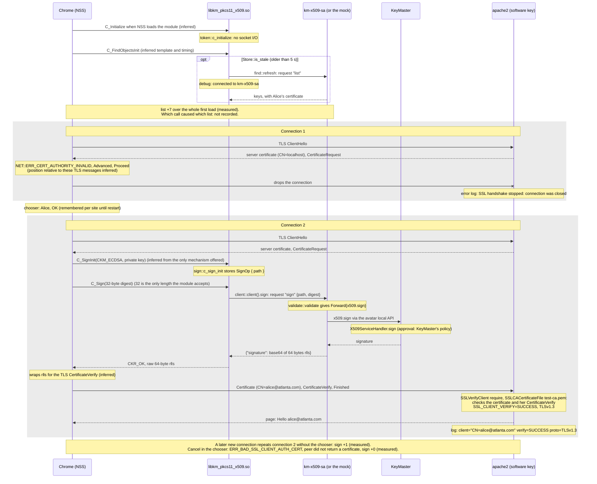

# Browser client authentication with a token-held key

Status: mission 37.1.6 (Chrome). Firefox follows in 37.1.7. Test identity: Alice
(`alice@atlanta.com`), mock km-x509-sa. Builds on the enrolment in
[x509-enrolment.md](x509-enrolment.md) (37.1.5).

This page describes acceptance demos: Alice reaches a page that requires client authentication,
using a certificate whose key is held by KeyMaster. The browser offers that certificate, and no key
file exists on the client side.

**The demos are run by hand, not in CI**, because a browser is a GUI: the warning page, the
certificate chooser and the error pages are things a person looks at. So this page has no script and
no sync check, unlike the enrolment and OpenVPN pages. Everything below was run by hand on 7 and
8 Nov 2026. Where something was not observed, the page says **not recorded**.

Chrome loads `libkm_pkcs11_x509.so` directly through NSS (`~/.pki/nssdb`), not through
p11-kit-proxy. The path of one page load:

```text
Chrome (NSS) -> libkm_pkcs11_x509.so (in the browser process)
    C_FindObjects (cert + key)                        -> km-x509-sa "list"
    C_SignInit(CKM_ECDSA) + C_Sign(32-byte digest)    -> km-x509-sa "sign"
apache2 (software server key) checks Alice's cert against test-ca.pem and her CertificateVerify
```

For how the pieces fit together, see [x509/overview.md](x509/overview.md). For the module, see
[x509/pkcs11-module.md](x509/pkcs11-module.md).

## Prerequisites

- **The module is built:** `target/release/libkm_pkcs11_x509.so`.
- **The 37.1.5 enrolment is done.** The steps as run are below.
- **The working directory is `~/km-demo`.** It holds test material only and is deleted at the end.
- **Chromium (not tested):** Ubuntu's Chromium is a snap. It was not tested here. It uses its own NSS
  database (reportedly `~/snap/chromium/current/.pki/nssdb`, not verified) and is confined, so this
  page uses the Google Chrome deb.

**Packages**, as run. Chrome's install makes itself the default for `x-www-browser` and
`gnome-www-browser`, so the two `update-alternatives` lines set those back.

```bash
wget https://dl.google.com/linux/direct/google-chrome-stable_current_amd64.deb
sudo apt install ./google-chrome-stable_current_amd64.deb
sudo update-alternatives --set x-www-browser /usr/bin/firefox
sudo update-alternatives --set gnome-www-browser /usr/bin/firefox
sudo apt install apache2
sudo apt install libnss3-tools pkcs11-provider
```

**Versions rehearsed** (Ubuntu 26.04):

| Item | Value |
|---|---|
| Chrome | Google Chrome 157.0.8103.38 (deb; apt source `/etc/apt/sources.list.d/google-chrome.sources`) |
| apache2 | 2.4.66-2ubuntu2.6 |
| NSS tools | `modutil`, `certutil` (libnss3-tools), NSS 3.120 |
| Module | `target/release/libkm_pkcs11_x509.so`, 801,992 bytes |
| `~/.pki/nssdb` before | only "NSS Internal PKCS #11 Module", no certificates |
| ufw | active, default deny incoming |

### The environment file

Create `~/km-demo`, put these lines in `~/km-demo/env.sh`, and run `source ~/km-demo/env.sh` in every
terminal:

```bash
cd ~/km-demo
export WORKDIR=$HOME/km-demo X509_SA_SOCK=$HOME/km-demo/mock-x509.sock
mstats() { python3 -c 'import socket,os; s=socket.socket(socket.AF_UNIX); s.connect(os.environ["X509_SA_SOCK"]); s.sendall(b"{\"jsonrpc\":\"2.0\",\"id\":1,\"method\":\"mock.stats\",\"params\":{}}\n"); print(s.makefile().readline().strip())'; }
```

`mstats` prints the mock's request counters (`list`, `sign`, `import`).

The commands on this page use the checkouts as rehearsed, with both repositories under
`~/projects/startup`. Adjust the paths if yours are elsewhere.

### p11-kit registration

A user-level registration. Only the enrolment script and the OpenSSL rig check need it. The browsers
do not use p11-kit.

```bash
mkdir -p ~/.config/pkcs11/modules
printf 'module: %s\ncritical: no\n' "$HOME/projects/startup/keymaster-avatar/target/release/libkm_pkcs11_x509.so" > ~/.config/pkcs11/modules/km-x509-dev.module
```

### The mock and the enrolment

```bash
cp ~/projects/startup/keymaster-e2e-test/src/test/resources/x509/{alice.tmpl,client.ext,server.ext} $WORKDIR/
setsid python3 ~/projects/startup/keymaster-avatar/crates/pkcs11-x509/tests/mock_x509_sa.py --socket $X509_SA_SOCK > $WORKDIR/mock.log 2>&1 < /dev/null &
~/projects/startup/keymaster-avatar/doc/x509-enrolment.sh make_test_pki
~/projects/startup/keymaster-avatar/doc/x509-enrolment.sh
```

**Success:** all 8 steps are ok. As rehearsed, the mock counted `list 19, sign 2, import 1`.

The certificates, from `openssl x509 -noout`:

| File | Subject | Issuer or SAN | Key usage, EKU | Valid |
|---|---|---|---|---|
| `alice.crt` | `CN=alice@atlanta.com` | issuer `CN=Test CA 37.1.5`, SAN `email:alice@atlanta.com` | keyUsage critical Digital Signature, EKU TLS Web Client Authentication | 1 year |
| `server.pem` | `CN=localhost` | SAN `DNS:localhost` | EKU TLS Web Server Authentication | **7 days** |

`server.pem` is valid for only 7 days, which matters if the Firefox demo is run later.

## The test server

apache2 serves one page that reports the client certificate it verified. It uses a software key and
certificate, not the token.

- **Loopback only.** The vhost listens on 127.0.0.1:8443 and nothing else. It is test material for a
  demo and has no reason to be reachable from another machine.
- **`SSLVerifyClient require` is at vhost level.** Chrome does not do TLS 1.3 post-handshake
  authentication, so a per-`<Location>` requirement would fail.

### A fresh apache

> These steps and the [cleanup](#cleanup) assume apache2 was installed for this demo. If you already
> use an apache on this machine, do not overwrite its `ports.conf`, and do not run the purge or the
> `rm -rf /etc/apache2`.

A newly installed apache2 listens on ports 80 and 443. To keep it off them:

```bash
sudo systemctl stop apache2
sudo systemctl disable apache2
sudo a2dissite 000-default
sudo cp /etc/apache2/ports.conf /etc/apache2/ports.conf.orig
echo '# km-demo: listeners come from sites-enabled/km-test.conf (127.0.0.1:8443 only)' | sudo tee /etc/apache2/ports.conf
sudo systemctl disable --now apache-htcacheclean
```

### Modules and page

```bash
sudo a2enmod ssl include
sudo mkdir -p /var/www/km-test
printf '<!doctype html><title>KeyMaster test</title><h1>Hello <!--#echo var="SSL_CLIENT_S_DN_CN" --></h1><p>Issuer: <!--#echo var="SSL_CLIENT_I_DN" --></p><p>Verify: <!--#echo var="SSL_CLIENT_VERIFY" --> / <!--#echo var="SSL_PROTOCOL" --></p>\n' | sudo tee /var/www/km-test/index.shtml
```

### The vhost

Write this to `/etc/apache2/sites-available/km-test.conf`. Replace `/home/<you>` with your own home
directory: apache does not expand `$HOME`.

```apache
Listen 127.0.0.1:8443
<VirtualHost 127.0.0.1:8443>
    ServerName localhost
    DocumentRoot /var/www/km-test
    DirectoryIndex index.shtml
    SSLEngine on
    SSLCertificateFile    /home/<you>/km-demo/server.pem
    SSLCertificateKeyFile /home/<you>/km-demo/server.key
    SSLCACertificateFile  /home/<you>/km-demo/test-ca.pem
    SSLVerifyClient require
    SSLVerifyDepth 1
    <Directory /var/www/km-test>
        Options +Includes
        SSLOptions +StdEnvVars
        AddOutputFilter INCLUDES .shtml
        Require all granted
    </Directory>
    LogFormat "%t \"%r\" %>s client=\"%{SSL_CLIENT_S_DN}x\" verify=%{SSL_CLIENT_VERIFY}x proto=%{SSL_PROTOCOL}x" kmtest
    CustomLog ${APACHE_LOG_DIR}/km-test.log kmtest
    ErrorLog  ${APACHE_LOG_DIR}/km-test-error.log
    LogLevel  info ssl:info
</VirtualHost>
```

Enable and start it:

```bash
sudo a2ensite km-test
sudo apache2ctl configtest
sudo systemctl start apache2
ss -ltn | grep -E ':80 |:443 |:8443 '      # only 127.0.0.1:8443
```

### Rig check (OpenSSL, no browser)

Do this before opening a browser. It tests the server and the token without any GUI. Run it from
`~/km-demo` (the environment file changes into it).

```bash
~/projects/startup/keymaster-avatar/doc/x509-openvpn.sh provider_conf      # writes $WORKDIR/ossl-pkcs11.cnf
CERT=$(p11tool --batch --list-all-certs --only-urls 'pkcs11:token=KeyMaster%20X.509' | grep tls-client)
PRIV=$(p11tool --batch --list-all --only-urls 'pkcs11:token=KeyMaster%20X.509' | grep tls-client | grep type=private)
printf 'GET / HTTP/1.0\r\nHost: localhost\r\n\r\n' | OPENSSL_CONF=$WORKDIR/ossl-pkcs11.cnf openssl s_client -connect 127.0.0.1:8443 -servername localhost -CAfile test-ca.pem -cert "$CERT" -key "$PRIV" -verify_return_error -quiet 2>/dev/null | tail -5
sudo tail -2 /var/log/apache2/km-test.log
```

**Success, with the token:**

- The page reads `Hello alice@atlanta.com / Issuer: CN=Test CA 37.1.5 / Verify: SUCCESS / TLSv1.3`.
- The log has `client="CN=alice@atlanta.com" verify=SUCCESS proto=TLSv1.3`.
- The mock counts 1 `sign`.

**Negative control, without `-cert`/`-key`:**

```bash
printf 'GET / HTTP/1.0\r\nHost: localhost\r\n\r\n' | OPENSSL_CONF=$WORKDIR/ossl-pkcs11.cnf openssl s_client -connect 127.0.0.1:8443 -servername localhost -CAfile test-ca.pem -verify_return_error -quiet 2>&1 | tail -3; echo "exit ${PIPESTATUS[1]}"
```

- It prints `exit 1` and `tlsv13 alert certificate required ... SSL alert number 116`.
- The apache error log has `peer did not return a certificate`.
- The mock counts 0 `sign`.

**Proves:** apache really requires a client certificate and accepts Alice's. A later failure in a
browser is about the browser's side.

Two apache log lines look wrong and are harmless:

- The error log labels the vhost `(server localhost:443)`, because `ServerName` has no port.
- `No CAs known to server for verification?` is OpenSSL's generic hint.

## Why we click through the server warning

Chrome shows `NET::ERR_CERT_AUTHORITY_INVALID` for this server, and we click through it. The
certificate is `CN=localhost` with SAN `DNS:localhost`, so there is no name mismatch on top.

**Never trust the test CA, in any browser.** Its key is a plain file in `~/km-demo`.

The browser does not need to trust the CA to offer a client certificate. Selection matches the issuer
name sent in the server's CertificateRequest.

## Chrome

### Register the module

Close Chrome first. `X509_SA_SOCK` must be set for `-list` and `certutil` to see the token.

```bash
modutil -dbdir sql:$HOME/.pki/nssdb -force -add keymaster -libfile $HOME/projects/startup/keymaster-avatar/target/release/libkm_pkcs11_x509.so
modutil -dbdir sql:$HOME/.pki/nssdb -list
certutil -d sql:$HOME/.pki/nssdb -L -h all
```

**Success:**

- `modutil -list` shows module `2. keymaster`, library `.../libkm_pkcs11_x509.so`, and 1 slot, with
  slot and token `KeyMaster X.509`.
- The module's uri is
  `pkcs11:library-manufacturer=DWDC;library-description=KeyMaster%20X.509%20PKCS%2311;library-version=0.1`.
- The token's uri is
  `pkcs11:token=KeyMaster%20X.509;manufacturer=DWDC;serial=0000000000000001;model=KeyMaster`.
- `certutil -L -h all` shows `KeyMaster X.509:alice@atlanta.com tls-client   u,u,u`. `u` means NSS
  paired the certificate with a private key on the token.
- There is no Test CA entry.

### Start Chrome

One terminal runs only Chrome and stays busy. Run the checks in another.

```bash
X509_SA_SOCK=$HOME/km-demo/mock-x509.sock KM_PKCS11_X509_DEBUG=1 google-chrome --user-data-dir=$HOME/km-demo/chrome-profile --no-first-run --password-store=basic https://localhost:8443/ 2>&1 | grep --line-buffered -i km_pkcs11 | tee $HOME/km-demo/chrome-km.log
```

- `--user-data-dir` gives the demo its own browser profile.
- `--password-store=basic` keeps the demo profile away from the GNOME keyring.
- The module logs `km_pkcs11_x509: connected to km-x509-sa` to Chrome's stderr.

### Load the page

1. The warning `NET::ERR_CERT_AUTHORITY_INVALID` appears. Choose Advanced, then Proceed to localhost
   (unsafe).
2. The certificate chooser appears. Select Alice and press OK.

**Success:**

- The page reads `Hello alice@atlanta.com / Issuer: CN=Test CA 37.1.5 / Verify: SUCCESS / TLSv1.3`.
- The apache log has
  `"GET / HTTP/1.1" 200 client="CN=alice@atlanta.com" verify=SUCCESS proto=TLSv1.3`.

**Proves:** Chrome offered a certificate whose key is on the token, and apache verified Alice.

### What the chooser shows

- Title "Select a certificate", text "Select a certificate to authenticate yourself to
  localhost:8443".
- Columns Subject, Issuer and Serial. One row: `alice@atlanta.com`, `Test CA 37.1.5`,
  `14EAEB7AF75AA...` (truncated).
- Buttons Certificate information, Cancel and OK.

**Finding: the account is clear, the purpose is not shown.** Chrome shows certificate fields (subject
CN, issuer CN, serial). It does not show the PKCS#11 label (`alice@atlanta.com tls-client`), the token
name or the EKU. The purpose is visible only through "Certificate information".

### How Chrome handles the request

The apache error log shows it. Chrome drops the first connection when the server asks for a
certificate (`SSL handshake stopped: connection was closed`), shows the chooser, then reconnects with
the chosen certificate. It remembers the choice per site until Chrome restarts.

### Declining

Start Chrome fresh and press Cancel in the chooser.

**Success:**

- Chrome shows the error page "Access to localhost was denied ... ERR_BAD_SSL_CLIENT_AUTH_CERT". It
  does not hang.
- The apache error log (`km-test-error.log`) has `peer did not return a certificate`.
- The mock counts 0 `sign`.
- At the next start, Alice and OK work again.

### Restart persistence

Close Chrome and start it again. The chooser offers Alice again and the page loads, without running
`modutil` again. `modutil -list` still shows `keymaster`.

### Not recorded

- Whether the server warning page came back after a Chrome restart.
- Whether the chooser appeared in a new tab.
- What "Certificate information" shows: it was not opened.

### The NSS database is shared

`~/.pki/nssdb` is shared by all Chrome profiles of the user. The separate `--user-data-dir` does
**not** isolate the module, so it also shows in a normal Chrome until it is removed.

### Remove the module

With Chrome closed:

```bash
modutil -dbdir sql:$HOME/.pki/nssdb -force -delete keymaster      # Chrome closed; then -list shows only NSS Internal
```

## Sequence: one page load with client authentication

This shows a first load in Chrome. The module's and km-x509-sa's parts are read from the code. The
TLS outcomes and the dropped connection come from the apache logs and the hand run above. What Chrome
and NSS do internally (which PKCS#11 calls, in which order, with which templates) is *(inferred)*.
Against the mock, the mock answers in place of km-x509-sa, the avatar and KeyMaster.



## Token interactions (measured)

Measured on 8 Nov 2026 in Chrome against the mock, as deltas of `mock.stats`. Baseline before Chrome:
list 22, sign 3.

| Event | sign | list | Notes |
|---|---|---|---|
| First load (Chrome start, warning, chooser, OK) | +1 | +7 | |
| Reload after more than 5 s idle | +1 | +1 | no chooser; new TCP connection, full handshake (no TLS resumption seen) |
| Two reloads 3 s apart | +1 | +0 | second reused the open connection |
| New tab, same URL | +1 | +2 | new connection |
| Chrome restart, load | +1 | +5 / +3 | measured twice; chooser again |
| Chrome restart, Cancel | +0 | +4 | ERR_BAD_SSL_CLIENT_AUTH_CERT |
| Restart after the decline, Alice | +1 | +3 | works again |

**Reading:** one `sign` per new TLS connection, not per page. apache closes idle connections after
5 s (`KeepAliveTimeout` default, not changed), so in practice nearly every page view after a pause
costs one `sign`. The cause of the missing resumption was not investigated.

`list` includes Chrome loading the token at startup, and also `modutil` and `certutil` calls, each of
which loads the module.

**For 37.2:** with the phone as token, expect one signing request per page view after 5 s idle, unless
resumption or a longer keep-alive is arranged.

## What else appears

Only one certificate exists in this demo. Which chooser shows a certificate depends on its EKU, and
`alice.crt` has `clientAuth` only.

**For 37.7:** once an S/MIME certificate from the same CA exists, it stays out of this chooser only
because of its EKU. The rows would otherwise look alike.

## Firefox (37.1.7)

To be written in 37.1.7.

## Troubleshooting

All of these happened during the hand run.

| Symptom | Cause and fix |
|---|---|
| No chooser, straight `ERR_BAD_SSL_CLIENT_AUTH_CERT`, apache `peer did not return a certificate`, mock `list` unchanged | Chrome was started from a terminal where `X509_SA_SOCK` was empty, so the module looked for the default socket, found no token and Chrome sent no certificate. Set `X509_SA_SOCK` (or source the environment file) and restart Chrome. |
| Starting Chrome again returns to the prompt at once | A demo Chrome with the same `--user-data-dir` is still running. The new command hands the URL to it and exits, and the running instance keeps its old environment. Close it fully: `pgrep -af 'km-demo/chrome-profile'` must print nothing. |
| Chrome exited right after `connected to km-x509-sa`, with no window, no leftover process and no lock file | Happened once (8 Nov 14:22). The next start worked. Not reproduced, cause unknown. |
| DevTools open: a request for `/.well-known/appspecific/com.chrome.devtools.json` gets a 404 | Chrome's own request. Harmless. |
| After a mock restart or a reboot, the token has a new key | The mock makes a new key at every start. Enrol Alice again (the 8 steps; `make_test_pki` is not needed, because the CA and server certificate are reused and the CA's serial file gives the new certificate serial+1). Restart Chrome as well. |
| After a reboot, nothing listens on 8443 | apache is disabled at boot: `sudo systemctl start apache2`. |

## Cleanup

Run this when you are finished with the browser demos, including Firefox if you plan to run it: it
removes the material both use. See the [warning about an existing apache](#a-fresh-apache).

```bash
modutil -dbdir sql:$HOME/.pki/nssdb -force -delete keymaster      # Chrome closed; then -list shows only NSS Internal
rm ~/.config/pkcs11/modules/km-x509-dev.module
sudo a2dissite km-test && sudo systemctl stop apache2
sudo apt purge apache2 apache2-bin apache2-data apache2-utils && sudo apt autoremove
sudo rm -rf /var/www/km-test /etc/apache2      # only if purge left them
pkill -f 'mock_x509_sa.py --socket'; rm -rf ~/km-demo
# Chrome: keep, or sudo apt purge google-chrome-stable (also removes google-chrome.sources)
```
