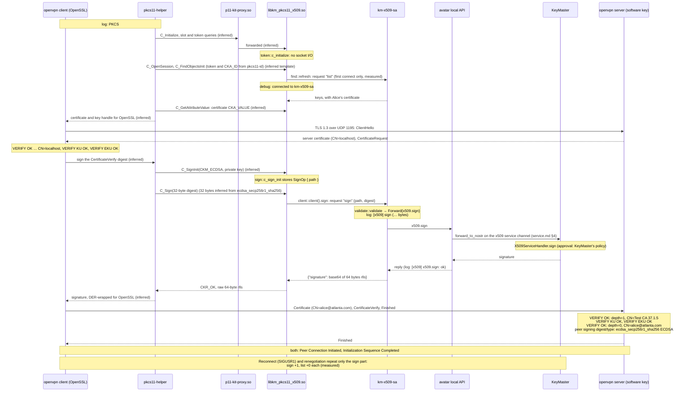

# OpenVPN with a token-held key

Status: mission 37.1.8. Test identity: Alice (`alice@atlanta.com`), desktop KeyMaster, or the mock
km-x509-sa. Builds on the enrolment in [x509-enrolment.md](x509-enrolment.md) (37.1.5).

This runbook brings up an OpenVPN tunnel whose client key stays in KeyMaster. The client config names
the key with `pkcs11-providers` + `pkcs11-id`. It has **no** `cert` and **no** `key` line.

1. **The OpenSSL gate first.** `openssl s_client`, going through pkcs11-provider, completes a
   client-auth handshake. It uses the key and certificate from the token, against a local
   `openssl s_server` with a software key. A negative control without a certificate must be refused.
2. **Then the tunnel.**
   - `openvpn --show-pkcs11-ids` lists Alice's certificate.
   - A local OpenVPN pair comes up with `pkcs11-id`.
   - It carries traffic and survives a reconnect.
   - A certificate from another CA is refused.
3. **The cost.** How many token interactions (`list`, `sign`) each event costs, as input for 37.2.

Scope: a LOCAL OpenVPN pair and the test PKI only. Never a production gateway, never `~/vpn`, never
a real VPN config.

The path of one handshake:

```text
openvpn (client, OpenSSL) -> pkcs11-helper -> p11-kit-proxy.so -> libkm_pkcs11_x509.so
  -> km-x509-sa ("list", "sign") -> KeyMaster signs
the OpenVPN server (software key) verifies Alice's certificate against test-ca.pem
and her CertificateVerify signature
```

**The commands are a script.** [`x509-openvpn.sh`](x509-openvpn.sh) holds every check on this page.
The code blocks marked as runbook blocks are copied from it verbatim
([sync check](#keeping-this-page-in-sync)). Starting and stopping OpenVPN differs by environment: a
network namespace on a laptop, two containers in e2e. So those commands are [here](#the-tunnel-by-hand)
and not in the script.

For how the pieces fit together, see [x509/overview.md](x509/overview.md). For the module, see
[x509/pkcs11-module.md](x509/pkcs11-module.md).

## Prerequisites

- **The 37.1.5 enrolment is done**: Alice's certificate is on the token. `WORKDIR` still holds
  `test-ca.pem`, `server.pem`, `server.key` (from `x509-enrolment.sh make_test_pki`) and `alice.crt`.
  This script never creates a key. Do not run it in a fresh directory.
- **Packages:** `sudo apt install openvpn pkcs11-provider`. pkcs11-provider installs
  `/usr/lib/x86_64-linux-gnu/ossl-modules/pkcs11.so`.
- **The module registered system-wide, for root as well.** OpenVPN runs as root, and root does not
  read `~/.config/pkcs11/modules`. Without the `keymaster-avatar` package, register the dev build in
  `/etc/pkcs11/modules/km-x509-dev.module`:

  ```text
  module: <absolute path>/target/release/libkm_pkcs11_x509.so
  critical: no
  ```

  Check that `p11-kit list-modules` shows token `KeyMaster X.509` both as yourself and with `sudo`.
  The package's `/usr/share/p11-kit/modules/keymaster.module` is read by root too.
- **`X509_SA_SOCK` through sudo.** As root, the module does not find km-x509-sa's socket by itself
  (see [the finding for 37.3](#finding-for-373-root-and-the-socket)). Pass it explicitly every time:
  `sudo env X509_SA_SOCK=… openvpn …`.
- **km-x509-sa, or the mock, running.** Start the mock with `setsid` so that it survives the
  terminal. A plain `&` job died with its terminal during the rehearsal, and its log just ended at
  `READY`.

  ```bash
  setsid python3 crates/pkcs11-x509/tests/mock_x509_sa.py --socket /tmp/mock-x509.sock \
      > "$WORKDIR/mock.log" 2>&1 < /dev/null &
  ```

  The mock makes a **new random key at every start**. After restarting it, enrol again
  (`x509-enrolment.sh`) and run `show_ids` again.
- **Versions rehearsed** (6 Nov 2026, Ubuntu 26.04): OpenVPN 2.7.0 `[PKCS11][DCO]`, OpenSSL 3.5.5,
  pkcs11-provider 1.2.0.
- **Ports:** 4434/tcp for the gate and 1195/udp for the tunnel. 4433 stays the enrolment script's.

## Inputs

There are two required inputs, `WORKDIR` and `X509_SA_SOCK`. Use the same `WORKDIR` as the
enrolment. The script changes into it itself.

```bash
export X509_SA_SOCK=/tmp/mock-x509.sock     # or your km-x509-sa socket
export WORKDIR=$HOME/x509-enrolment         # the 37.1.5 WORKDIR
cd "$WORKDIR"
```

The defaults, as the script sets them:

<!-- runbook settings -->
```bash
TOKEN_LABEL="${TOKEN_LABEL:-KeyMaster X.509}"
CA_CERT="${CA_CERT:-test-ca.pem}"
SERVER_CERT="${SERVER_CERT:-server.pem}"
SERVER_KEY="${SERVER_KEY:-server.key}"
CERT_FILE="${CERT_FILE:-alice.crt}"
GATE_PORT="${GATE_PORT:-4434}"
OSSL_PKCS11="${OSSL_PKCS11:-/usr/lib/x86_64-linux-gnu/ossl-modules/pkcs11.so}"
P11KIT_PROXY="${P11KIT_PROXY:-/usr/lib/x86_64-linux-gnu/p11-kit-proxy.so}"
OSSL_CONF_FILE="${OSSL_CONF_FILE:-ossl-pkcs11.cnf}"
SERVER_ADDR="${SERVER_ADDR:-10.98.0.2}"
# No colon: unset means $SERVER_ADDR; set to "" means no "local" line.
LOCAL_ADDR="${LOCAL_ADDR-$SERVER_ADDR}"
VPN_PORT="${VPN_PORT:-1195}"
VPN_DEV="${VPN_DEV:-tunkm0}"
LOCAL_TUN="${LOCAL_TUN:-10.99.0.2}"
PEER_TUN="${PEER_TUN:-10.99.0.1}"
TOKEN_URL="pkcs11:token=${TOKEN_LABEL// /%20}"
```

- `SERVER_ADDR` is the client's `remote`. `LOCAL_ADDR` is the server's `local`, and defaults to
  `SERVER_ADDR`.
- **`LOCAL_ADDR=""`** (set but empty) leaves the `local` line out, so the server listens on all its
  addresses. The e2e test needs this, because there the server container listens on its own address.
  An unset `LOCAL_ADDR` keeps the default.
- `LOCAL_TUN` and `PEER_TUN` are named from the client's side: the client is 10.99.0.2 and the server
  is 10.99.0.1. The server's `ifconfig` therefore uses them the other way round.
- `CERT_FILE` (`alice.crt`) is read only for the expected CN, `CN=alice@atlanta.com`.

## Running it

```bash
doc/x509-openvpn.sh                 # provider_conf openssl_gate openssl_gate_without_cert show_ids write_configs
doc/x509-openvpn.sh show_ids        # or one step at a time
doc/x509-openvpn.sh tunnel_check    # only with a tunnel up (see below)
```

The output works as in the enrolment script:

- `STEP: …` lines say what a step did. Each passed check prints `ok   STEP: …`.
- The first failed check prints `FAIL STEP: …` and the failing command's output.
- Exit 0 means everything passed, 1 means a check failed, 2 means a setup error (a missing variable,
  file or tool, or a port in use).
- Logs are in `$WORKDIR/logs/`. The client and server logs (`gate.log`, `server-gate.log`, …) are in
  `$WORKDIR`.
- Each step checks only the tools it uses.

**Key material is never printed.** `openssl s_client` prints the TLS session: `Master-Key`,
`Resumption PSK`, and the session ticket as a hex dump. The `s_server -www` page echoes the server's
view of the same session. These are session secrets, not Alice's key, but the script still blanks
them in its log files before it checks or shows anything. **If you run the blocks by hand, your
`gate.log` keeps those values.** Treat it accordingly.

Steps called one at a time run in separate processes. The key URLs and the CKA_ID are therefore
looked up from the token every time. The only value handed from one step to the next is
`$WORKDIR/pkcs11-id`, written by `show_ids` and read by `write_configs`.

To run the blocks by hand, paste them into one shell in `WORKDIR` after the settings block.

## 1. Provider config (`provider_conf`)

pkcs11-provider lets OpenSSL 3 use `pkcs11:` URIs as keys and certificates. It is configured **only**
for the gate's client, through `OPENSSL_CONF`. The system `openssl.cnf` is not touched.

<!-- runbook provider_conf -->
```bash
cat > "$OSSL_CONF_FILE" <<EOF
openssl_conf = openssl_init
[openssl_init]
providers = provider_sect
[provider_sect]
default = default_sect
pkcs11 = pkcs11_sect
[default_sect]
activate = 1
[pkcs11_sect]
module = $OSSL_PKCS11
pkcs11-module-path = $P11KIT_PROXY
activate = 1
EOF
```

<!-- runbook provider_conf.check -->
```bash
OPENSSL_CONF="$OSSL_CONF_FILE" openssl list -providers
```

**Success:** the list shows `default` (version 3.5.5 as rehearsed) and `pkcs11` (1.2.0), each with
`status: active`. The script prints both versions.

## 2. The OpenSSL gate (`openssl_gate`)

This step must pass before you try any tunnel. It runs the same key, certificate and CA as OpenVPN
will, through OpenSSL, with nothing OpenVPN-specific in between.

The key and certificate URIs are looked up from the token each time, as in the enrolment. First the
private key:

<!-- runbook key_urls -->
```bash
PRIV=$(p11tool --batch --list-all --only-urls "$TOKEN_URL" | grep 'tls-client' | grep 'type=private')
```

The server uses a software key, not the token. It runs in the background. The script waits for the
port by reading `/proc/net/tcp` for up to 10 s and stops the server at the end of the step. In the
script, `SERVER_LOG` is `server-gate.log`; by hand, set `SERVER_LOG=server-gate.log` first and stop
the server afterwards with `kill %1`.

<!-- runbook openssl_gate.server -->
```bash
stdbuf -oL -eL openssl s_server -accept "$GATE_PORT" -cert "$SERVER_CERT" -key "$SERVER_KEY" -CAfile "$CA_CERT" \
    -Verify 1 -verify_return_error -www > "$SERVER_LOG" 2>&1 &
```

`stdbuf` line-buffers the server's output, so its log is complete even though the server is killed.
`-Verify 1 -verify_return_error` makes a client certificate mandatory.

Then the certificate URI, and the client:

<!-- runbook openssl_gate.cert -->
```bash
CERT=$(p11tool --batch --list-all-certs --only-urls "$TOKEN_URL" | grep 'tls-client')
```

<!-- runbook openssl_gate.client -->
```bash
printf 'GET / HTTP/1.0\r\n\r\n' | OPENSSL_CONF="$OSSL_CONF_FILE" openssl s_client -connect localhost:"$GATE_PORT" \
    -CAfile "$CA_CERT" -cert "$CERT" -key "$PRIV" -verify_return_error -ign_eof > gate.log 2>&1
```

Both `-cert` and `-key` take the `pkcs11:` URIs directly. No PEM export is needed.

**Success:**

- s_client exits 0.
- `gate.log` has `Protocol: TLSv1.3`. As rehearsed it also has `Cipher is TLS_AES_256_GCM_SHA384` and
  `Verify return code: 0 (ok)`.
- The server's `-www` page, returned to the client, has a **`Client certificate`** section with
  `Subject: CN=alice@atlanta.com` and SAN `email:alice@atlanta.com`. It also has `Peer signature
  type: ecdsa_secp256r1_sha256`, which is the server's view of Alice's CertificateVerify.
- `server-gate.log` has `depth=1 CN=Test CA 37.1.5`, `verify return:1`, `depth=0 CN=alice@atlanta.com`,
  `verify return:1`.

**Proves:** OpenSSL, through pkcs11-provider, p11-kit and the module, loaded Alice's certificate from
the token and had the token sign the TLS 1.3 CertificateVerify. The server verified both. As
rehearsed this was done with the module unchanged, at a token cost of `sign` +1 and `list` +1.

The module offers only `CKM_ECDSA`, and the signature succeeded, so CKM_ECDSA over a 32-byte digest
was used *(inferred, not observed)*.

## 3. Negative control: no client certificate (`openssl_gate_without_cert`)

The same server is started, with `SERVER_LOG=server-gate-nocert.log`. The client runs without
`-cert`/`-key`. It also runs without `OPENSSL_CONF`, because nothing needs the token, and as rehearsed
the token is not touched.

<!-- runbook openssl_gate_without_cert.client -->
```bash
printf 'GET / HTTP/1.0\r\n\r\n' | openssl s_client -connect localhost:"$GATE_PORT" -CAfile "$CA_CERT" \
    -verify_return_error -ign_eof > gate-nocert.log 2>&1
```

**Success:**

- s_client exits non-zero (1 as rehearsed).
- `gate-nocert.log` has `tlsv13 alert certificate required … SSL alert number 116`.
- There is no `Client certificate` section and no `CN=alice@atlanta.com`.
- The server log has `peer did not return a certificate`.

**Do not judge by `Verify return code: 0 (ok)`.** The client prints it here too, because it is the
client's check of the *server's* certificate.

**Proves:** the server really requires a client certificate, so step 2's success came from Alice's.

## 4. Find the pkcs11-id (`show_ids`)

<!-- runbook show_ids -->
```bash
openvpn --show-pkcs11-ids "$P11KIT_PROXY" > show-pkcs11-ids.txt 2>&1
```

<!-- runbook show_ids.extract -->
```bash
sed -n 's/^ *Serialized id: *//p' show-pkcs11-ids.txt > pkcs11-id
```

The script runs this as the calling user. It works the same as root (`sudo env X509_SA_SOCK=…
openvpn --show-pkcs11-ids`); as rehearsed, both print the same apart from the timestamp. Without an
argument, OpenVPN also defaults to `p11-kit-proxy.so`.

**Success:**

- openvpn exits 0, with exactly one `Certificate` block:

  ```text
  Certificate
         DN:             CN=alice@atlanta.com
         Serial:         <cert serial hex>
         Serialized id:  DWDC/KeyMaster/0000000000000001/KeyMaster\x20X\x2E509/<CKA_ID as 64 upper-case hex>
  ```

- `pkcs11-id` holds exactly that one line.
- The script also checks that the id starts with the token strings and that its last part equals the
  key's CKA_ID from `p11tool`.

**Cost:** 1 `list`, 0 `sign`, for the bare command. The script's own `p11tool` lookup adds more.

### pkcs11-id is not a URI

`pkcs11-id` is **not** an RFC 7512 `pkcs11:` URI, and a `pkcs11:` URI does not work there. It is
pkcs11-helper's own serialised id. **Copy it from `openvpn --show-pkcs11-ids`**, never by hand.

- **Format:** `manufacturer/model/serial/token label/CKA_ID`. Here that is
  `DWDC/KeyMaster/0000000000000001/KeyMaster\x20X\x2E509/<64 hex>`. The space and the dot in the
  label are escaped as `\x20` and `\x2E`. The id contains no object label.
- **It changes with the key.** The last part is the CKA_ID, which is the SHA-256 of the key's
  SubjectPublicKeyInfo.
  - The mock makes a new key at every start, and the id changed with it.
  - With the real KeyMaster the key is derived deterministically, so the id is stable. A different
    key still means **every** client config must be updated.
  - So the script and the e2e test extract it on every run and never hard-code it.
- **The token strings are frozen.** Label `KeyMaster X.509`, manufacturer `DWDC`, model `KeyMaster`
  and serial `0000000000000001` (`token.rs`) are part of every `pkcs11-id`. Once a config uses them,
  changing any of them breaks that config
  ([pkcs11-module.md §8](x509/pkcs11-module.md#owner-decisions-3714)).

## 5. Write the configs (`write_configs`)

Point-to-point TLS mode: `tls-server` / `tls-client` with `ifconfig` on both sides, not a server with
an address pool. The server uses the software `server.pem`/`server.key` from the test PKI and
`dh none`. Each side checks the other's role with `remote-cert-tls`.

<!-- runbook write_configs.server -->
```bash
cat > server.ovpn <<EOF
dev $VPN_DEV
dev-type tun
proto udp
EOF
[ -z "$LOCAL_ADDR" ] || printf 'local %s\n' "$LOCAL_ADDR" >> server.ovpn
cat >> server.ovpn <<EOF
port $VPN_PORT
tls-server
ifconfig $PEER_TUN $LOCAL_TUN
ca $CA_CERT
cert $SERVER_CERT
key $SERVER_KEY
dh none
remote-cert-tls client
ping 5
verb 4
EOF
```

The client has no `cert` and no `key`:

<!-- runbook write_configs.client -->
```bash
cat > alice-test.ovpn <<EOF
dev $VPN_DEV
dev-type tun
proto udp
remote $SERVER_ADDR $VPN_PORT
nobind
tls-client
ifconfig $LOCAL_TUN $PEER_TUN
ca $CA_CERT
remote-cert-tls server
pkcs11-providers $P11KIT_PROXY
ping 5
verb 4
EOF
```

<!-- runbook write_configs.pkcs11_id -->
```bash
printf "pkcs11-id '%s'\n" "$(cat pkcs11-id)" >> alice-test.ovpn
```

`printf %s` keeps the backslashes in the id literally. The single quotes stop OpenVPN from
interpreting them.

**Success:**

- With the defaults, both files match the rehearsed configs.
- `alice-test.ovpn` has no `cert`, `key` or `pkcs12` line.
- It has exactly one `pkcs11-id` line, and that line equals `pkcs11-id '<content of pkcs11-id>'`
  byte for byte.
- With `LOCAL_ADDR=""`, `server.ovpn` has no `local` line.

Notes:

- `remote-cert-tls` also requires a keyUsage extension. `client.ext` and `server.ext` both have
  `keyUsage=critical,digitalSignature`, so both sides log `VERIFY KU OK`.
- OpenVPN warns `--ping should normally be used with --ping-restart or --ping-exit`. That is harmless
  here.
- TLS 1.3 with P-256 gives `ecdsa_secp256r1_sha256`, a 32-byte digest, which is the only length the
  module accepts. TLS 1.3 was negotiated everywhere, so the configs have no `tls-version-min`. If a
  `CKR_DATA_LEN_RANGE` (a 48-byte digest) ever shows up, add `tls-version-min 1.3` to the test config.
  Do not change the module for this.

## The tunnel, by hand

These commands need root and a network namespace, so they are not in the script and are not covered
by the sync check. Run them from `WORKDIR`: the configs use relative paths.

**Namespace:** the server lives in `kmvpn`, joined to the host by a veth pair. The host side is
`kmv0` 10.98.0.1/30 and the namespace side is `kmv1` 10.98.0.2/30.

```bash
sudo ip netns add kmvpn
sudo ip link add kmv0 type veth peer name kmv1
sudo ip link set kmv1 netns kmvpn
sudo ip addr add 10.98.0.1/30 dev kmv0
sudo ip link set kmv0 up
sudo ip -n kmvpn addr add 10.98.0.2/30 dev kmv1
sudo ip -n kmvpn link set kmv1 up
sudo ip -n kmvpn link set lo up
```

**Server** (terminal 1, software key, no token):

```bash
cd "$WORKDIR" && sudo ip netns exec kmvpn openvpn --config server.ovpn
```

**Client** (terminal 2). It runs as root, so pass the socket:

```bash
cd "$WORKDIR" && sudo env X509_SA_SOCK="$X509_SA_SOCK" openvpn --config alice-test.ovpn
```

**Client log, in order:**

- `PKCS#11: Adding PKCS#11 provider '/usr/lib/x86_64-linux-gnu/p11-kit-proxy.so'`
- `km_pkcs11_x509: connected to km-x509-sa`
- `VERIFY OK … CN=localhost`
- `Control Channel: TLSv1.3 …`
- `[localhost] Peer Connection Initiated`
- `Initialization Sequence Completed`

**Server log.** This is the proof that the server verified Alice:

- `VERIFY OK: depth=1, CN=Test CA 37.1.5`
- `VERIFY KU OK`
- `VERIFY EKU OK`
- `VERIFY OK: depth=0, CN=alice@atlanta.com`
- `Control Channel: TLSv1.3 … peer signing digest/type: ecdsa_secp256r1_sha256 ECDSA`
- `[alice@atlanta.com] Peer Connection Initiated`
- `Initialization Sequence Completed`

**DCO.** Both sides use DCO automatically (`ovpn-dco device [tunkm0] opened`, interface type
`ovpn`), and it works, so the configs have no `disable-dco`. In containers, DCO depends on the host
kernel's `ovpn` module. In containers without the `ovpn` kernel module, OpenVPN falls back to the
tun device by itself (e2e log: `Kernel support for ovpn-dco missing, disabling data channel
offload`); the token side is the same either way.

### 6. Traffic (`tunnel_check`)

With the tunnel up, in a third terminal:

```bash
doc/x509-openvpn.sh tunnel_check
```

<!-- runbook tunnel_check.route -->
```bash
ip route get "$PEER_TUN"
```

<!-- runbook tunnel_check.ping -->
```bash
ping -c3 -W2 "$PEER_TUN"
```

**Success:** the route says `dev tunkm0` (as rehearsed: `10.99.0.1 dev tunkm0 src 10.99.0.2`), and
ping gets 3 of 3 replies. Traffic does not touch the token.

### Reconnect (SIGUSR1)

Send the signal **only to the openvpn process**:

```bash
sudo kill -USR1 $(pgrep -f '^openvpn --config alice-test.ovpn')
```

Do **not** use `pkill -f alice-test.ovpn`. It also matches the `sudo` and `sudo env` wrappers, whose
command lines contain the same text. sudo relays signals to its child, so openvpn could receive the
signal two or three times. The `^openvpn` anchor matches only the process whose command line starts
with `openvpn`.

**Success:** the client logs `SIGUSR1[hard,] received, process restarting` and
`Restart pause, 2 second(s)`, then a new `Peer Connection Initiated` and
`Initialization Sequence Completed`. `tunnel_check` passes again.

### Renegotiation

Add `--reneg-sec 30` to the client's command line:

```bash
cd "$WORKDIR" && sudo env X509_SA_SOCK="$X509_SA_SOCK" openvpn --config alice-test.ovpn --reneg-sec 30
```

**Success:**

- The client logs `TLS: soft reset sec=30/30 …`, then a new `Control Channel: TLSv1.3 …`.
- Each time, the server logs a new `VERIFY OK: depth=0, CN=alice@atlanta.com`.
- The tunnel stays up (ping keeps working).

### Negative control: a certificate from another CA

1. Make a throwaway CA `Other CA 37.1.8` and a software client certificate `CN=mallory@example.test`
   with the same `client.ext`. Generate the keys at run time and never commit them.
2. Make the client config: Alice's, minus the two `pkcs11-` lines, plus `cert`/`key` for Mallory's
   files.
3. The client retries forever, so run it under `timeout`. Put `timeout` after `sudo`, so that its
   signal reaches openvpn directly:

```bash
sudo timeout 20 openvpn --config mallory-test.ovpn; echo "exit $?"
```

**Success:**

- Exit 124.
- The server logs `VERIFY ERROR: depth=0, error=unable to get local issuer certificate:
  CN=mallory@example.test`, then `TLS Error: TLS handshake failed`.
- The client logs `Received fatal SSL alert: unknown CA` and never `Initialization Sequence
  Completed`.
- The token is untouched.

**Config sanity:** Alice's config minus the `pkcs11-` lines, with no `cert`/`key` either, exits 1
immediately with `Options error: You must define certificate file (--cert) or PKCS#12 file
(--pkcs12)`. The message does not mention `--pkcs11-id`.

### Cleanup

Stop the client, then **stop the server before deleting the namespace**:

```bash
# Ctrl-C in both terminals (client first, then server), then:
sudo ip netns del kmvpn
ip link show kmv0    # should report: Device "kmv0" does not exist.
```

`ip netns del` only removes the name. If openvpn is still running inside, the namespace and `kmv1`
live on and `kmv0` stays up on the host. Once the server has exited, `kmv0` disappears by itself.

## Token interactions (measured)

**Laptop, mock km-x509-sa, OpenVPN 2.7.0, bare commands:**

Measured on 6 Nov 2026 against the mock, as deltas of `mock.stats`. The counts are for the bare
commands. The script's own `p11tool` lookups add `list` calls of their own.

| Event | sign | list | Time |
|---|---|---|---|
| OpenSSL gate handshake (s_client) | 1 | 1 | - |
| openvpn --show-pkcs11-ids | 0 | 1 | - |
| First connect | 1 | 1 | TLS ~7 ms (first packet -> Peer Connection Initiated); start -> "Initialization Sequence Completed" ~1.2 s (measured twice; the rest is OpenVPN data-channel setup, not the token) |
| Reconnect (SIGUSR1) | 1 | 0 | 3.17 s signal -> Initialization Sequence Completed, of which 2 s is OpenVPN's fixed "Restart pause" |
| Renegotiation (--reneg-sec 30) | 1 | 0 | ~7 ms, tunnel stays up. Measured: 2 renegotiations in 65 s -> sign +2, list +0; overall 5 renegotiations + 1 first connect = sign 6, list 1, server verified Alice 6 times |
| Idle 60 s (keepalive pings) | 0 | 0 | - |
| Failed client start (tun device busy) | 0 | 1 | pkcs11-helper loads the token before opening the tun device |

**e2e, real km-x509-sa + KeyMaster, keymaster-e2e-test `X509OpenVpnTest`, OpenVPN 2.6.14 / OpenSSL
3.5.7 (Debian trixie), data path TUN (container: `Kernel support for ovpn-dco missing, disabling
data channel offload`), e2e 56/56 on 6 Nov 2026.** Measured identically in two runs (class alone
and full gate).

| Event | sign | list | Time |
|---|---|---|---|
| OpenSSL gate (script step `openssl_gate`) | 1 | 3 | - (the script's own `p11tool` lookups add `list` calls) |
| Gate without cert | 0 | 0 | - |
| `show_ids` (script step) | 0 | 2 | - (includes the script's CKA_ID cross-check) |
| First connect | 1 | 1 | ~2.1 s start -> Initialization Sequence Completed (polled every 250 ms) |
| Reconnect (SIGUSR1) | 1 | 1 | ~2.9 s signal -> ISC, incl. the 2 s restart pause |
| Renegotiation (reneg-sec 15) | 1 | 0 | - |
| Client with a cert from another CA (refused) | 0 | 0 | - |

**For 37.2 (the C_Login decision):**

- Every handshake costs **exactly one `sign`**, in both setups.
- `list`: 1 on first connect in both. On reconnect (SIGUSR1) it differs: 0 on OpenVPN 2.7.0
  (mock), 1 on 2.6.14 (real km-x509-sa). The cause is not verified (likely the OpenVPN /
  pkcs11-helper version), so plan for **1 `sign` + up to 1 `list` per reconnect**.
- Renegotiation: 1 `sign`, 0 `list` in both.
- OpenVPN's default `reneg-sec` is 3600, so a running tunnel means **one phone signing request per
  tunnel per hour, plus one per reconnect**. Whatever login or approval means on the phone has to fit
  that rhythm: a prompt per renegotiation would interrupt the user once an hour for as long as the
  tunnel is up.

## Finding for 37.3: root and the socket

OpenVPN runs as root, so the module, running inside OpenVPN's process, does not find km-x509-sa's
socket by itself. Its fallbacks are `$XDG_RUNTIME_DIR/keymaster-x509-sa.sock` and
`/run/user/<getuid()>/…`, and for root that is uid 0, not the user's runtime directory
([pkcs11-module.md §3](x509/pkcs11-module.md#3-talking-to-km-x509-sa)).

By hand, this is solved with `sudo env X509_SA_SOCK=…` and a system-wide module registration.

A real deployment (NetworkManager, `openvpn-client@.service`) runs outside the user session.
**Socket discovery must be solved there**: which socket a root-owned OpenVPN uses, and who is allowed
to open it.

## Sequence: one OpenVPN client handshake

This shows a first connect. The module's, km-x509-sa's and the server's parts are read from the code
or from the logs above. What OpenVPN and pkcs11-helper do internally (which calls, in which order,
with which templates) is *(inferred)*: it is drawn from their logs and from the measured `list`/`sign`
counts, not from their source. Against the mock, the mock answers in place of km-x509-sa, the avatar
and KeyMaster.



## Troubleshooting

| Symptom | Cause |
|---|---|
| `km_pkcs11_x509: list refresh failed: Transport("connect: Connection refused (os error 111)")`, then `PKCS#11: Unable get x509 certificate object`, `Cannot load certificate … using PKCS#11 interface`, and a MISLEADING `Error: private key password verification failed` | km-x509-sa (or the mock) is not reachable: it is not running, or `X509_SA_SOCK` was not passed through sudo. |
| `ERROR: Cannot ioctl TUNSETIFF tunkm0: Invalid argument (errno=22)` | Another openvpn already owns `tunkm0` (an earlier client is still running). |
| `--show-pkcs11-ids` lists nothing as root | The module is registered only in `~/.config/pkcs11/modules`, which root does not read, or `X509_SA_SOCK` was not passed. |
| A pkcs11-id that worked yesterday now gives `Cannot load certificate` | The key changed, so the CKA_ID is new. Re-run `show_ids` and `write_configs`. With the mock this happens after every restart. |
| `kmv0` still exists after `ip netns del kmvpn` | The server was still running inside the namespace. Stop it; `kmv0` then disappears. |
| `Options error: You must define certificate file (--cert) or PKCS#12 file (--pkcs12)` | The `pkcs11-id` (or `pkcs11-providers`) line is missing from the client config. |
| `port 4434 is already in use` | Another server is running there (an earlier `s_server` started by hand?). Stop it, or set `GATE_PORT`. |
| `CKR_DATA_LEN_RANGE` in a handshake | A 48-byte digest (not TLS 1.3 with P-256). Set `tls-version-min 1.3` in the test config; see [step 5](#5-write-the-configs-write_configs). |

**The module's debug output is sparse.** `KM_PKCS11_X509_DEBUG=1` (`lib.rs`, `debug_log!`) prints
events such as `connected to km-x509-sa` and transport failures such as `list refresh failed: …`. It
does **not** print a trace of every `C_` call, so do not expect one. For a call trace, put a
PKCS#11 spy module between p11-kit and the module.

## Keeping this page in sync

Each block on this page that is preceded by a `<!-- runbook NAME -->` comment is a copy of the lines
between `# >>> runbook NAME` and `# <<< runbook` in `x509-openvpn.sh`, without the function's 4-space
indent. Blocks without such a comment (the tunnel by hand) are not checked. Run this from the
repository root. It prints nothing but `runbook in sync` when the two match:

```bash
diff <(awk '/^ *# >>> runbook /{n=$NF;p=1;next} /^ *# <<< runbook/{p=0} p{sub(/^    /,"");print n": "$0}' doc/x509-openvpn.sh) \
     <(awk '/^<!-- runbook /{n=$3;f=1;next} f&&/^```bash$/{p=1;next} p&&/^```$/{p=f=0;next} p{print n": "$0}' doc/x509-openvpn.md) \
  && echo "runbook in sync"
```
