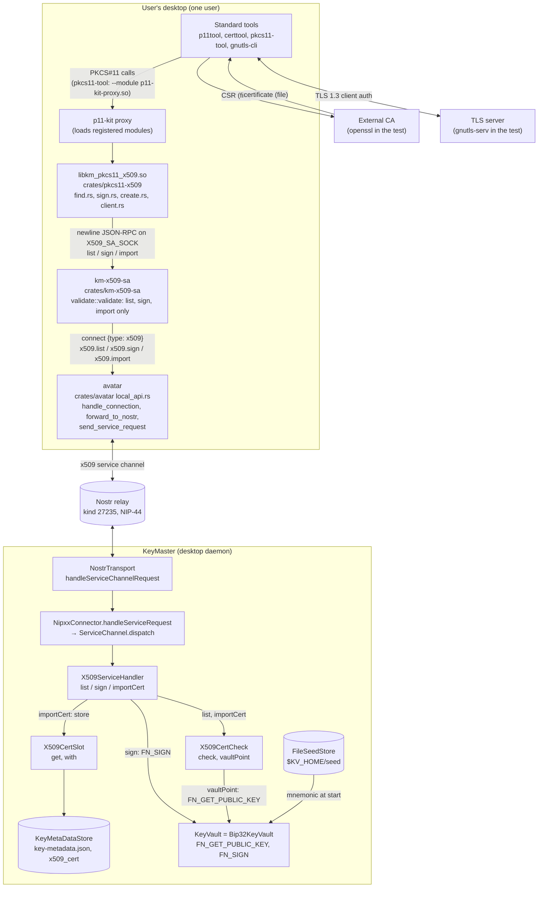
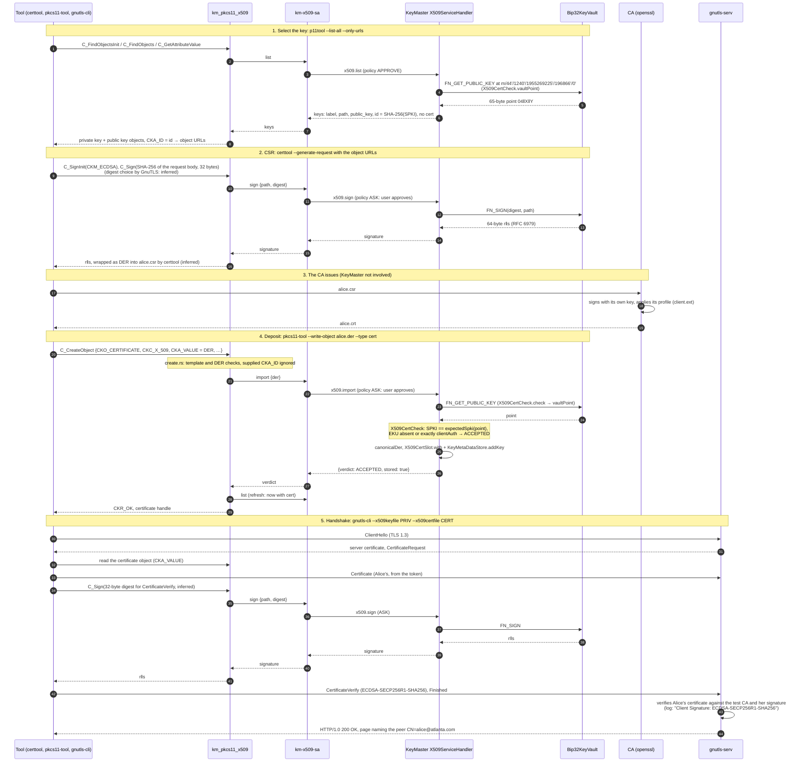

# X.509 in KeyMaster: overview of mission 37.1

This page is for newcomers. It shows how the parts of mission 37.1 fit together; the per-part
documents hold the detail.

Class, file and function names were read from the code, and the module and service avatar names come
from their documents, which were themselves written from the code. Anything that is not read but
inferred is marked *(inferred)*.

## Purpose

KeyMaster derives an X.509 key for each identity (P-256, ECDSA), from the same seed as its SSH,
OpenPGP and Nostr keys. Mission 37.1 makes that key usable by ordinary PKCS#11 software (GnuTLS,
OpenSSL via OpenSC, OpenVPN, Firefox) **without the private key ever leaving KeyMaster**. Alice can
then request a certificate from any CA and use it for TLS client authentication.

| Part | What it added | Document |
|---|---|---|
| 37.1.1 | ECDSA P-256 in the vault: `Bip32KeyVault` derives the public point and signs 32-byte digests (raw `r‖s`) | [keyvault/doc/ecdsa-p256.md](../../../keyvault/doc/ecdsa-p256.md) |
| 37.1.2 | The key's path (`IdentityPaths.x509`), its label (`alice@atlanta.com tls-client`), `X509CertCheck` (does a certificate carry this key, with an allowed EKU?) and `X509CertSlot` (where an accepted certificate is stored) | [keymaster/doc/x509.md](../../../keymaster/doc/x509.md) |
| 37.1.3 | The `"x509"` service channel: `X509ServiceHandler` (`list`, `sign`, `import`) in KeyMaster, and the service avatar `km-x509-sa` with its local socket | [service.md](service.md), [keymaster/doc/x509.md § X.509 Service](../../../keymaster/doc/x509.md#x509-service) |
| 37.1.4 | The PKCS#11 module `libkm_pkcs11_x509.so`: the token "KeyMaster X.509", which shows each key as a private and a public key (plus a certificate once enrolled); signing is `CKM_ECDSA`; `C_CreateObject` enrols a certificate | [pkcs11-module.md](pkcs11-module.md) |
| 37.1.5 | The enrolment: an external CA issues Alice's certificate, requested through the token with standard tools, and a TLS client-auth handshake proves it | [x509-enrolment.md](../x509-enrolment.md) (runbook) and [x509-enrolment.sh](../x509-enrolment.sh) (the same commands as a script; the e2e test runs it) |

## Components

How the diagram maps to the code:

- **`X509ServiceHandler` calls the vault directly** to sign (`vault.execute(KeyVault.FN_SIGN, …)`).
  `X509CertCheck.vaultPoint` asks the vault only for the public point. `X509CertSlot` never touches
  the vault: it reads and writes the `x509_cert` metadata of a `KeyEntry` in the `KeyMetaDataStore`.
- **`list` also uses `X509CertCheck`:** `X509ServiceHandler.list` calls `X509CertCheck.vaultPoint` and
  `expectedSpki` to compute each key's `id` (SHA-256 of the SPKI), and reads `X509CertSlot.get`
  (through `storedCert`) for the stored certificate.
- **The vault is `Bip32KeyVault`** in the desktop daemon. `DaemonController` constructs
  `new Bip32KeyVault(seedStore.getMnemonic(), seedStore.getPassphrase())`, and the daemon's `Main`
  passes it a `FileSeedStore`.
- **The relay leg** is detailed in [service.md §4](service.md#4-request-flow): attach, channel keys and
  sender binding.

## The enrolment, end to end

Participants:

- The tools: certtool, pkcs11-tool and gnutls-cli, each loading the module through p11-kit.
- The module.
- km-x509-sa.
- KeyMaster (`X509ServiceHandler`).
- The vault (`Bip32KeyVault`).
- The CA.
- The server (gnutls-serv).

Between km-x509-sa and KeyMaster, every request also passes through the avatar and the relay
([service.md §4](service.md#4-request-flow)); the diagram leaves them out.

What the module and KeyMaster do was read from their code. Which PKCS#11 calls GnuTLS and OpenSC make
is *(inferred)*, following the module document. So is the internals of the CA and the server, which
were observed only through their output.

The negative control repeats step 5 without the client certificate. The server answers with alert
116 ("Certificate is required") and serves no page.

## Where the private keys are

| Key | Select | CSR | CA issues | Deposit | Handshake |
|---|---|---|---|---|---|
| **Alice's TLS client key** (`m/44'/1240'/1955269225'/196866'/0'`) | in `Bip32KeyVault`: only the public point is returned | in the vault: derived for the call, signs a 32-byte digest, only `r‖s` leaves | not used | in the vault: only the public point is read, for the SPKI comparison | in the vault: signs the CertificateVerify digest, only `r‖s` leaves |
| The token's "private key" object | a reference: `CKA_SENSITIVE` true, `CKA_EXTRACTABLE` false, `CKA_VALUE` answers `CKR_ATTRIBUTE_SENSITIVE` | same | – | same | same |
| CA key | – | – | the CA's own file (`test-ca.key` in the test) | – | – |
| Server key | – | – | – | – | gnutls-serv's software file (`server.key` in the test) |
| x509 channel keys | the avatar's channel key is in avatar memory; KeyMaster's is in the vault (`decryptViaVault` / `encryptViaVault`) | same | – | same | same |

The vault derives the leaf private key from the seed on each call (`derivator.derive(path)` in
`Bip32KeyVault.sign`; see [ecdsa-p256.md](../../../keyvault/doc/ecdsa-p256.md)). Only the point and
signatures leave it. No tool, the module, km-x509-sa and the avatar ever see Alice's private key.
Neither does the CA: it sees only the CSR.

## What is protected and what is not

**Protected:**

- **The private key never leaves KeyMaster.** Every use is a `sign` of a 32-byte digest, and the
  token's key object is sensitive and non-extractable.
- **Certificate and key must belong together.** `X509CertCheck` accepts a certificate only if its
  SPKI is exactly the key's (byte for byte) and its EKU is absent or exactly the role's (`clientAuth`
  for `tls-client`). Anything else is `KEY_MISMATCH` or `EKU_MISMATCH`, and nothing is stored.
- **Only the three methods reach KeyMaster.** km-x509-sa forwards only `list`, `sign` and `import`
  with well-formed parameters. KeyMaster accepts x509-channel requests only from the avatar's x509
  service key ([service.md §8](service.md#8-what-this-does-not-protect-against)).

**Not protected:**

- **The desktop KeyMaster keeps the seed in a file.** `FileSeedStore` stores the BIP-39 mnemonic in
  plain text at `$KV_HOME/seed` (default `~/.config/keyvault/seed`, mode 0600). Anyone who can read
  that file has every key. The desktop KeyMaster is **a test harness, not custody**. Custody moves to
  the phone in 37.2.
- **Same-user processes.** km-x509-sa's socket is `0600`, but it does not authenticate its clients.
  The module runs inside each consumer's process and does not authenticate its caller either.
- **Blind signing.** A `sign` request carries only `path` and `digest`, so whoever approves cannot
  see what is being signed.
- **No PIN.** `C_Login` accepts any PIN. Approval is KeyMaster's policy: ASK for `sign` and `import`,
  or `auto` (used by the e2e tests), which approves everything.
- **Import does not judge trust.** The chain, issuer, validity dates and revocation are not checked
  at import. An expired certificate, or one from an unknown CA, is stored if key and EKU match.
  Trust is the relying party's decision (the TLS server's).
- **Test keys.** The test CA key and server key are throwaway software keys, generated at run time.

## Further reading

- [x509-enrolment.md](../x509-enrolment.md): the runbook, with troubleshooting.
- [pkcs11-module.md](pkcs11-module.md): objects, attributes, signing, `C_CreateObject`, tool findings.
- [service.md](service.md): km-x509-sa's socket protocol, the request flow, channel key derivation.
- [keymaster/doc/x509.md](../../../keymaster/doc/x509.md): roles, paths, `X509CertCheck`,
  `X509ServiceHandler`.
- [keyvault/doc/ecdsa-p256.md](../../../keyvault/doc/ecdsa-p256.md): P-256 derivation and signing in
  the vault.
