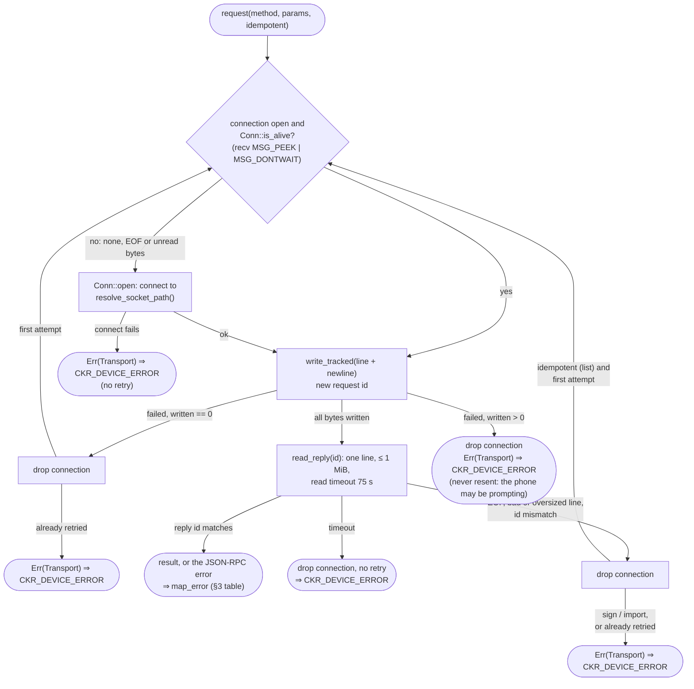
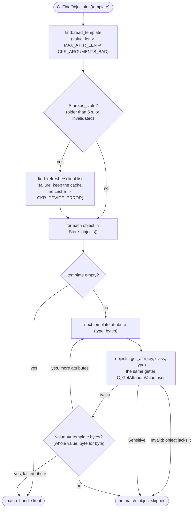
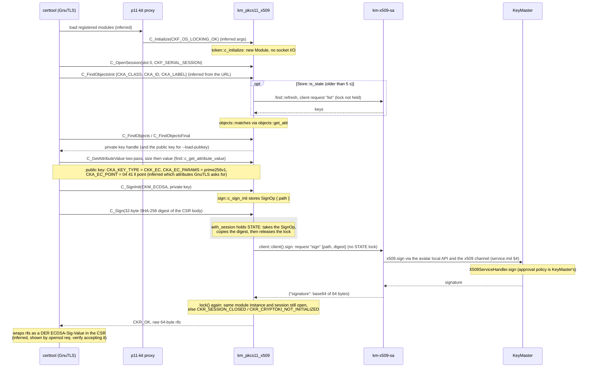
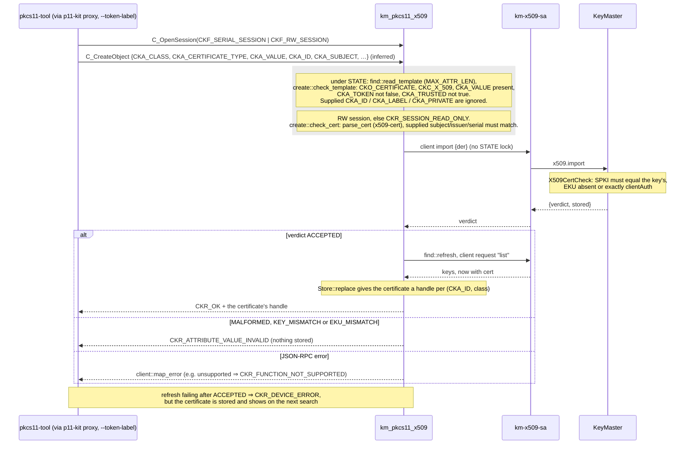

# km_pkcs11_x509: PKCS#11 module for KeyMaster X.509 keys

Function and file names in this document were read from the code. Where a
statement is inferred rather than read, it is marked *(inferred)*. Statements
about PKCS#11 v2.40 *rules* (as opposed to constant values) are from the v2.40
specification text, not from a file on this machine; the unit tests pin each
one.

## 1. Purpose

`libkm_pkcs11_x509.so` lets PKCS#11 applications (GnuTLS `p11tool`/`certtool`,
OpenSC `pkcs11-tool`, OpenVPN, Firefox/NSS) use the X.509 keys KeyMaster
serves. It is a thin client of [km-x509-sa](service.md)'s socket. Each
KeyMaster key appears as a private key and a public key, plus a certificate
once one has been enrolled. Signing is `CKM_ECDSA`. A certificate is enrolled
with `C_CreateObject`, which forwards it to km-x509-sa `import`. The module
never builds certificates and never holds key material.

`pkcs11-gpg` (`libkm_pkcs11_gpg.so`) is separate, unchanged and unregistered.

## 2. Code map

| File | Responsibility |
|---|---|
| `crates/pkcs11-x509/src/lib.rs` | The static `CK_FUNCTION_LIST` (v2.40), `C_GetFunctionList` (the only exported symbol), `guard` (a panic becomes `CKR_GENERAL_ERROR`), `debug_log!`. |
| `src/types.rs` | Hand-written Cryptoki types and constants, each with its line in `/usr/include/p11-kit-1/p11-kit/pkcs11.h`. `ALL_CONSTANTS` feeds the header test. |
| `src/client.rs` | km-x509-sa client: framing, timeouts, retry rule, `map_error`, `resolve_socket_path`. |
| `src/objects.rs` | `parse_list`, `parse_cert` (x509-cert), `KeyEntry`, `Store` (cache + handle table), **`get_attr`** (the only attribute getter) and `matches`. |
| `src/session.rs` | `STATE` (module state), sessions, login. |
| `src/token.rs` | `C_Initialize`, `C_Finalize`, info, slot, token, mechanisms (no I/O). |
| `src/find.rs` | `C_FindObjects*`, `C_GetAttributeValue`, `C_GetObjectSize`, refused copy/set/destroy, `refresh`. |
| `src/sign.rs` | `C_SignInit`, `C_Sign`. |
| `src/create.rs` | `C_CreateObject` (certificates only). |
| `src/stubs.rs` | Every function not offered. |
| `src/tests/` | `unit.rs` (no socket) and `mock.rs` (against the mock, `#[ignore]`). |
| `tests/mock_x509_sa.py` | Mock km-x509-sa (python3 + `cryptography`). |
| `tests/fixtures/` | A certificate DER and its subject, issuer and serial, cut out with `openssl asn1parse`. |
| `scripts/pkcs11-x509-smoke.sh` | Real-tool smoke test against the mock. |

## 3. Talking to km-x509-sa

**Socket path**, resolved on every connect (`client::resolve_socket_path`):
`$X509_SA_SOCK` (the name km-x509-sa prints at startup), else
`$XDG_RUNTIME_DIR/keymaster-x509-sa.sock`, else
`/run/user/<getuid()>/keymaster-x509-sa.sock`. Empty values count as unset.

**Protocol.** Newline-delimited JSON-RPC 2.0, as in [service.md §3](service.md#3-client-socket-protocol):
`list` → `{"keys":[{label, path, public_key, id, cert?}]}`,
`sign {path, digest}` → `{signature}` (64 bytes, r‖s),
`import {der}` → `{verdict, stored}`. The module uses its own request ids.

**Connection.** One persistent connection, opened lazily, under its own
mutex (`client::CLIENT`). Read timeout 75 s (km-x509-sa answers within about
70 s), write timeout 10 s. The connection is **dropped** after a timeout, a
read error, EOF, an unparsable or over-long (> 1 MiB) line, or a reply whose
`id` is not the request's. A late reply can therefore never be taken as the
answer to the next request.

**Retry rule.** Before each request a non-blocking `recv(MSG_PEEK)` checks the
connection; EOF or unread bytes mean it is stale, and it is replaced before
anything is written. A request is re-sent on a new connection only if **no
byte of it was written**. A `sign` or `import` that was (partly) sent is never
re-sent: the phone may already be prompting. `list` is idempotent and may be
retried once after a broken connection, but not after a timeout.

`client::Client::request` (`client.rs`), with `idempotent = true` only for
`list`:



**When I/O happens.** Never in `C_Initialize`, `C_GetInfo`, the slot, token
and mechanism queries, sessions or login. Only in `C_FindObjectsInit` (cache
refresh), `C_Sign` and `C_CreateObject`. The module state lock is never held
during I/O.

### Error mapping (`client::map_error`)

| km-x509-sa reply | CK_RV |
|---|---|
| -32603 `avatar unavailable`, -32001, -32002, -32003 | `CKR_DEVICE_ERROR` |
| -32603 `request denied by user` | `CKR_FUNCTION_REJECTED` |
| -32603 `unknown-path` | `CKR_KEY_HANDLE_INVALID`, and the key list is refreshed |
| -32603 `invalid-digest` | `CKR_DATA_LEN_RANGE` |
| -32603 `unsupported` | `CKR_FUNCTION_NOT_SUPPORTED` |
| -32700, -32600, -32601, -32602 | `CKR_GENERAL_ERROR` |
| our timeout, I/O error, EOF, bad line, id mismatch | `CKR_DEVICE_ERROR` (connection dropped) |
| anything else (including -32004, `sign failed: …`) | `CKR_FUNCTION_FAILED` |

KeyMaster's messages count only with code -32603, since km-x509-sa and
KeyMaster share that code and the message is the contract.

## 4. Objects

One slot (id 0), token always present. Per key from `list`:

- a private key and a public key, always;
- a certificate, only if the key has `cert`. There is no placeholder
  certificate: before enrolment the token shows **two** objects per key.

All objects of a key share `CKA_ID` = `list.id` = SHA-256 of the key's DER
SubjectPublicKeyInfo, as KeyMaster delivers it. The module never rebuilds the
SPKI from `CKA_EC_POINT`.

**Handles** are allocated per `(CKA_ID, class)` the first time an object is
seen and are never reused for anything else. Order in the list does not
matter. An object that disappears from the list gives
`CKR_OBJECT_HANDLE_INVALID`; if it comes back, it has its old handle.

**Cache.** The `list` result is cached per module instance and refreshed by
`C_FindObjectsInit` when older than 5 s, after a successful import, and after
`unknown-path`. If a refresh fails, the cached list is used; with no cache at
all, `C_FindObjectsInit` returns `CKR_DEVICE_ERROR`. A list entry with a bad
point, id, label or path is skipped; a `cert` that is not valid DER hides only
the certificate object.

### Attribute table (`objects::get_attr`)

"–" means the object does not have the attribute: `CKR_ATTRIBUTE_TYPE_INVALID`.

| Attribute | Private key | Public key | Certificate |
|---|---|---|---|
| CKA_CLASS | CKO_PRIVATE_KEY | CKO_PUBLIC_KEY | CKO_CERTIFICATE |
| CKA_TOKEN | true | true | true |
| CKA_PRIVATE | false | false | false |
| CKA_ID | `list.id` (32 bytes) | same | same |
| CKA_LABEL | `list.label` | same | same |
| CKA_MODIFIABLE, CKA_COPYABLE, CKA_DESTROYABLE | false | false | false |
| CKA_KEY_TYPE | CKK_EC | CKK_EC | – |
| CKA_EC_PARAMS | `06 08 2a 86 48 ce 3d 03 01 07` (prime256v1) | same | – |
| CKA_EC_POINT | – | `04 41` ‖ 65-byte point (DER OCTET STRING) | – |
| CKA_SIGN | true | – | – |
| CKA_VERIFY | – | true | – |
| CKA_SENSITIVE, CKA_ALWAYS_SENSITIVE, CKA_NEVER_EXTRACTABLE | true | – | – |
| CKA_EXTRACTABLE, CKA_DECRYPT, CKA_DERIVE, CKA_UNWRAP, CKA_ALWAYS_AUTHENTICATE | false | – | – |
| CKA_VALUE | sensitive: `CKR_ATTRIBUTE_SENSITIVE` | – | certificate DER |
| CKA_CERTIFICATE_TYPE | – | – | CKC_X_509 |
| CKA_SUBJECT, CKA_ISSUER | – | – | DER `Name` from the certificate |
| CKA_SERIAL_NUMBER | – | – | the whole DER INTEGER (tag, length, value) |
| CKA_CERTIFICATE_CATEGORY | – | – | 1 (token user) |
| CKA_TRUSTED | – | – | false |

Booleans are one byte; `CK_ULONG` values are 8 bytes, native-endian.
Certificate fields are parsed with RustCrypto `x509-cert` 0.2: its
`SerialNumber::to_der()` gives the full INTEGER that `CKA_SERIAL_NUMBER`
needs (x509-parser's `raw_serial()` gives only the value bytes), and its
dependency tree is small (`der`, `spki`, `const-oid`). It accepts DER only.

**`C_GetAttributeValue`** (v2.40 §5.7) processes every entry, even after an
error:

| Getter result | `pValue` | `ulValueLen` becomes | Return code |
|---|---|---|---|
| value | NULL | its size | — |
| value | buffer too small | `CK_UNAVAILABLE_INFORMATION` | `CKR_BUFFER_TOO_SMALL` |
| value | big enough | its size (value copied) | — |
| sensitive | any | `CK_UNAVAILABLE_INFORMATION` | `CKR_ATTRIBUTE_SENSITIVE` |
| not present | any | `CK_UNAVAILABLE_INFORMATION` | `CKR_ATTRIBUTE_TYPE_INVALID` |

When several errors apply, the one set last is returned (v2.40 allows any).

**`C_FindObjectsInit`** matches each template attribute by asking the same
`get_attr` and comparing the whole value byte for byte. No prefix or substring
matching. An attribute the object lacks, or a sensitive one, never matches. An
empty template matches everything.



`objects::matches` is `template.iter().all(…)`, so the first failing
attribute ends the check for that object.

## 5. Functions

"Session checks" = `CKR_CRYPTOKI_NOT_INITIALIZED`, then
`CKR_SESSION_HANDLE_INVALID`.

| Function | Behaviour and return codes |
|---|---|
| C_GetFunctionList | NULL → `ARGUMENTS_BAD`. Works before `C_Initialize`. |
| C_Initialize | Args: `pReserved` ≠ NULL → `ARGUMENTS_BAD`; only some mutex callbacks → `ARGUMENTS_BAD`; all four without `CKF_OS_LOCKING_OK` → `CANT_LOCK`. Second call → `CRYPTOKI_ALREADY_INITIALIZED`. No I/O. |
| C_Finalize | `pReserved` ≠ NULL → `ARGUMENTS_BAD`. Drops sessions, operations, cache, login and (if idle) the connection. |
| C_GetInfo | cryptoki 2.40, `DWDC`, `KeyMaster X.509 PKCS#11`, library version = crate version. |
| C_GetSlotList / C_GetSlotInfo | One slot, id 0, `CKF_TOKEN_PRESENT`. Other slot ids → `SLOT_ID_INVALID` (0x3). |
| C_GetTokenInfo | Label `KeyMaster X.509`, manufacturer `DWDC`, model `KeyMaster`, serial `0000000000000001`. Flags `CKF_TOKEN_INITIALIZED` only. Max sessions `CK_EFFECTIVELY_INFINITE`, real session counts. |
| C_GetMechanismList / Info | `[CKM_ECDSA]`; 256/256 bits, `CKF_SIGN \| CKF_EC_F_P \| CKF_EC_NAMEDCURVE \| CKF_EC_UNCOMPRESS`. Anything else → `MECHANISM_INVALID`. |
| C_OpenSession | Any number of sessions; handles never reused. No `CKF_SERIAL_SESSION` → `SESSION_PARALLEL_NOT_SUPPORTED`. `CKF_RW_SESSION` is tracked. |
| C_CloseSession / C_CloseAllSessions | Closing the last session logs out. |
| C_GetSessionInfo | `CKS_RO/RW_PUBLIC_SESSION`, or `CKS_RO/RW_USER_FUNCTIONS` when logged in. |
| C_Login | Login applies to the whole module (all sessions). Any PIN, even NULL. Already logged in → `USER_ALREADY_LOGGED_IN`. `CKU_SO` → `USER_TYPE_INVALID`. `CKU_CONTEXT_SPECIFIC` → `OPERATION_NOT_INITIALIZED`. What login should mean on the phone is open (37.2). |
| C_Logout | Not logged in → `USER_NOT_LOGGED_IN`; otherwise logs every session out. |
| C_FindObjectsInit / C_FindObjects / C_FindObjectsFinal | One search per session; second init → `OPERATION_ACTIVE`. |
| C_GetAttributeValue | §4. |
| C_GetObjectSize | `CK_UNAVAILABLE_INFORMATION`, `CKR_OK`. |
| C_CopyObject, C_SetAttributeValue, C_DestroyObject | Valid handle → `ACTION_PROHIBITED`; else `OBJECT_HANDLE_INVALID`. |
| C_SignInit | See §6. |
| C_Sign | See §6. |
| C_CreateObject | See §7. |
| C_GetFunctionStatus, C_CancelFunction | `CKR_FUNCTION_NOT_PARALLEL` (v2.40 legacy rule). |
| everything else | `CKR_FUNCTION_NOT_SUPPORTED`, including multi-part signing, verify, key generation and random. |

## 6. Signing

`C_SignInit(CKM_ECDSA, private key)` remembers the key's `path`. Errors:
NULL mechanism → `ARGUMENTS_BAD`; operation already active →
`OPERATION_ACTIVE`; another mechanism → `MECHANISM_INVALID`; a mechanism
parameter → `MECHANISM_PARAM_INVALID`; a public key →
`KEY_FUNCTION_NOT_PERMITTED`; a certificate or unknown handle →
`KEY_HANDLE_INVALID`.

`C_Sign(data)`: `data` is the digest.

- `pSignature == NULL` → `*pulSignatureLen = 64`, `CKR_OK`, the operation stays active.
- Buffer below 64 bytes → length 64, `CKR_BUFFER_TOO_SMALL`, stays active.
- Data not exactly **32 bytes** → `CKR_DATA_LEN_RANGE`. This is a deliberate
  restriction: v2.40 lets `CKM_ECDSA` take any length. Future option, not
  implemented: pass the leftmost 256 bits of a longer digest (standard ECDSA
  truncation) if a consumer sends SHA-384.
- Otherwise km-x509-sa `sign` is called and the raw 64-byte r‖s is returned
  (no DER; GnuTLS and OpenSC wrap it themselves).

Every outcome except the two "stays active" cases ends the operation. Errors
follow §3.

### Sequence: certtool signs a CSR

What the module does is read from the code. What GnuTLS and p11-kit do is
*(inferred)*: from the object URL's `id=`/`object=`/`type=` and from the
pkcs11-spy trace made during the smoke test.



## 7. Enrolling a certificate: `C_CreateObject`

Checked in this order:

1. Session checks; NULL template or `phObject` → `ARGUMENTS_BAD`.
2. No `CKA_CLASS` → `TEMPLATE_INCOMPLETE`; a class other than
   `CKO_CERTIFICATE` → `TEMPLATE_INCONSISTENT` (key creation is not offered).
   No `CKA_CERTIFICATE_TYPE` → `TEMPLATE_INCOMPLETE` (v2.40 requires it); not
   `CKC_X_509` → `ATTRIBUTE_VALUE_INVALID`. No `CKA_VALUE` →
   `TEMPLATE_INCOMPLETE`. `CKA_TOKEN = false` → `TEMPLATE_INCONSISTENT`.
   `CKA_TRUSTED = true` → `ATTRIBUTE_READ_ONLY`.
3. Read-only session → `SESSION_READ_ONLY`.
4. `CKA_VALUE` must parse as a DER certificate (else `ATTRIBUTE_VALUE_INVALID`,
   nothing is sent). A supplied `CKA_SUBJECT`, `CKA_ISSUER` or
   `CKA_SERIAL_NUMBER` must equal the certificate's, else
   `TEMPLATE_INCONSISTENT`.
5. km-x509-sa `import {der}`. `ACCEPTED` → the list is refreshed and the new
   certificate object's handle returned. `MALFORMED`, `KEY_MISMATCH`,
   `EKU_MISMATCH` → `ATTRIBUTE_VALUE_INVALID`, nothing stored. If the refresh
   after `ACCEPTED` fails, the result is `CKR_DEVICE_ERROR`, but the
   certificate is stored and appears on the next search.

A supplied `CKA_ID`, `CKA_LABEL` or `CKA_PRIVATE` is ignored: KeyMaster's id
and label win. KeyMaster decides whether the certificate fits a key: SPKI
equal to the key's, and no EKU or exactly `clientAuth` for a TLS-client key
(`X509CertCheck.java`).

### Sequence: pkcs11-tool --write-object --type cert

pkcs11-tool's own calls (which attributes it puts in the template) are
*(inferred)*; the module's checks are read from `create.rs`.



## 8. Deviations from PKCS#11 v2.40

- `CKM_ECDSA` accepts only 32-byte input (§6).
- `C_CreateObject` ignores `CKA_ID`, `CKA_LABEL` and `CKA_PRIVATE`, and accepts
  a template without `CKA_SUBJECT` (v2.40 lists it as required for X.509
  certificates).
- Attributes v2.40 defines for these classes but the table in §4 omits
  (`CKA_START_DATE`, `CKA_LOCAL`, `CKA_PUBLIC_KEY_INFO`, `CKA_SIGN_RECOVER`, …)
  answer `CKR_ATTRIBUTE_TYPE_INVALID`.
- There is no security officer (`CKU_SO` → `CKR_USER_TYPE_INVALID`) and no PIN.

### Owner decisions (37.1.4)

- **Resend only if nothing was written.** A `sign` or `import` whose request
  was (partly) sent is never re-sent; `list` may be retried once after a broken
  connection (§3).
- **Login is module-wide** (v2.40): `C_Login` on one session makes every
  session a user session; `C_Logout`, or closing the last session, ends it.
- **A supplied `CKA_ID` in `C_CreateObject` is ignored.** KeyMaster's SPKI check
  decides which key a certificate belongs to; the certificate then carries that
  key's `CKA_ID`.
- **Handles are stable per (`CKA_ID`, class)** and never reused for another object.
- **`C_Sign` requires exactly 32 bytes.** Passing the leftmost 256 bits of a
  longer digest (standard ECDSA truncation) is the future option.
- **`CKA_PRIVATE = false`** on every object, so tools see the keys without a login.
- **Token strings:** label `KeyMaster X.509`, manufacturer `DWDC`, model
  `KeyMaster`, serial `0000000000000001`. Frozen once an OpenVPN config or a
  Firefox profile refers to them.

### Tool findings

- **GnuTLS needs an object URL** (`id=`/`object=`) to load a private key; a
  token URL with `type=private` opens a session, never searches, and fails with
  "requested data were not available".
- **p11tool 3.8** has no `--list-all-pubkeys` (use `--list-all --only-urls` and
  pick `type=public`), and exits 2 with "No matching objects found" when a search
  is empty.
- **pkcs11-tool defaults to `opensc-pkcs11.so`**, so it needs
  `--module /usr/lib/x86_64-linux-gnu/p11-kit-proxy.so --token-label "KeyMaster X.509"`
  (or `--module` pointing straight at `libkm_pkcs11_x509.so`).
- **pkcs11-tool sends input longer than 32 bytes via `C_SignUpdate`.**
  `CKM_ECDSA` is single-part here, so that gets `CKR_FUNCTION_NOT_SUPPORTED`; a
  single-part `C_Sign` of the wrong length gets `CKR_DATA_LEN_RANGE`.

## 9. What this does not protect against

- **The module runs inside every consumer's process.** OpenVPN, Firefox,
  certtool each load their own copy, with their own sessions and their own
  connection. Whatever such a process asks the module to do, it can do; the
  module does not authenticate its caller.
- **Any process of the user that can open the socket can request signatures**,
  with or without this module: km-x509-sa's socket is `0600` and it does not
  authenticate its clients ([service.md §8](service.md#8-what-this-does-not-protect-against)).
- **No PIN on the desktop.** `C_Login` accepts any PIN and checks nothing; what
  login should mean on the phone is decided in 37.2. Approval is KeyMaster's
  policy (ASK for `sign` and `import`, or `auto`).
- **Blind signing.** The module signs whatever 32-byte digest it is given. The
  `sign` request carries only `path` and `digest`, so whoever approves on the
  phone cannot see what is being signed.
- **The debug log** (`KM_PKCS11_X509_DEBUG=1`) must never include digests, DER,
  signatures or paths. Today every `debug_log!` call prints only a method name,
  an import verdict, a fixed text, or an `RpcError` (codes and messages from
  km-x509-sa and KeyMaster, which by their own rules never contain values).
  Any new call must keep to that.

## 10. Registering the module

**Package.** `/usr/lib/keymaster-avatar/lib/libkm_pkcs11_x509.so`, registered
with p11-kit by `/usr/share/p11-kit/modules/keymaster.module`:

```
module: /usr/lib/keymaster-avatar/lib/libkm_pkcs11_x509.so
critical: no
```

**Development** (no root, no package): a user module file
`~/.config/pkcs11/modules/km-x509-dev.module` with
`module: <repo>/target/release/libkm_pkcs11_x509.so`. Remove it when done.
`scripts/pkcs11-x509-smoke.sh` creates and removes it itself.

**GnuTLS needs an object URL for a private key.** A token URL such as
`pkcs11:token=KeyMaster%20X.509;type=private` is not enough: GnuTLS opens a
session, never searches, and reports "requested data were not available". Use
the URL with `id=` / `object=` that `p11tool --list-all-privkeys --only-urls`
(public key: `--list-all --only-urls`, `type=public` line) prints for the token, e.g. for `certtool
--load-privkey`, `p11tool --export-pubkey` and `--test-sign`.

GnuTLS tools load p11-kit's registered modules. `pkcs11-tool` defaults to
`opensc-pkcs11.so`; use `--module /usr/lib/x86_64-linux-gnu/p11-kit-proxy.so`
or `--module <path to libkm_pkcs11_x509.so>`.

**Token strings** are frozen by the first OpenVPN config or Firefox profile
that refers to them: label `KeyMaster X.509`, manufacturer `DWDC`, model
`KeyMaster`, serial `0000000000000001` (`token.rs`).

**Debugging:** `KM_PKCS11_X509_DEBUG=1` prints diagnostics on stderr. They
never contain digests, DER, signatures or paths. The module writes no files.

## 11. How it's tested

**Unit tests** (`cargo test -p pkcs11-x509`, no socket, `src/tests/unit.rs`),
named after these DoD items:

| DoD | What |
|---|---|
| D1 | Every constant in `types.rs` equals the installed header's value (`d1_types_match_installed_header`; skipped if the header is missing). |
| D2 | Function list: version 2.40, 68 non-NULL entries. |
| D3 | `C_Initialize` argument rules; second call. |
| D4 | Init, info, slot, token, mechanisms, sessions and login never connect (connection counter). |
| D5 | Token and slot strings, flags, counts; `CKR_SLOT_ID_INVALID` = 0x3. |
| D6 | Mechanism list and info. |
| D7 | Several sessions with their own operations; RO/RW; module-wide login. |
| D8 | Two objects without a certificate, three with; bad list entries skipped. |
| D9 | The attribute table for each class; subject, issuer and serial against `openssl asn1parse` cut-outs. |
| D10 | `CKA_ID` = SHA-256(SPKI) for the doc's Alice key. |
| D11 | Two-pass `C_GetAttributeValue`. |
| D12 | Search: exact match through the same getter, no prefix/substring, sensitive never matches, and `find({a: get(a)})` contains the object for every readable attribute. |
| D13 | Handles stable across refresh and reorder; vanished → invalid; never reused. |
| D14 | No cache and no socket → `CKR_DEVICE_ERROR`. |
| D15 | Two-call `C_Sign`, the 32-byte rule, `C_SignInit` errors. |
| D16 | The error table; socket path resolution. |
| D19 | `C_CreateObject` template rules; invalid templates never reach the socket. |
| D20 | Key creation and object changes refused; stubs. |
| D21 | `C_Finalize` rules, re-initialization. |
| D22 | NULL arguments return `CKR_ARGUMENTS_BAD`; no files created. |

**Mock tests** (`src/tests/mock.rs`, `#[ignore]`; need AF_UNIX and
`python3-cryptography`; run with
`cargo test -p pkcs11-x509 -- --include-ignored`) start
`tests/mock_x509_sa.py` on a fresh socket. They cover the real `list`
(D8/D10), refresh and cache fallback (D14), signatures verified by the mock
(D15), error mapping through the socket (D16), timeout, late reply, wrong id
and garbage each dropping the connection (D17), the retry rule (D18: a stale
connection is replaced before writing; a sign that was sent is never re-sent;
`list` retried once), and `C_CreateObject` end to end (D19).

The mock has one software P-256 key, generated at start and never written to
disk, with Alice's label and path. It validates parameters like km-x509-sa,
applies KeyMaster's import rules, and has mock-only `mock.*` methods for
fault injection, counters, issuing certificates and verifying signatures (see
its docstring).

**Smoke test** (`scripts/pkcs11-x509-smoke.sh`, real tools against the mock):
token listing; `p11-kit list-modules` shows the module and token; two objects
with ID = SHA-256(SPKI); the key's object URLs; no certificate yet;
`--export-pubkey` and `p11tool --test-sign` with the object URL; a `certtool`
CSR that `openssl req -verify` accepts, with SPKI hash = `CKA_ID`;
`pkcs11-tool` raw 64-byte and OpenSSL-verified ECDSA signatures; a 48-byte
input refused (`pkcs11-tool` sends it multi-part, so
`CKR_FUNCTION_NOT_SUPPORTED`; single-part `C_Sign` gives `CKR_DATA_LEN_RANGE`);
a private-key write refused; a `certtool` self-signed certificate imported
with `pkcs11-tool --write-object --type cert` through the p11-kit proxy, as
37.1.5 will (three objects, one ID, one certificate); `p11tool --write` only if
the slot is still empty; a foreign certificate refused.

**e2e** (`keymaster-e2e-test`, tests 75–79): list, sign, import and refusal
with the real KeyMaster through p11tool/certtool in the avatar container.
