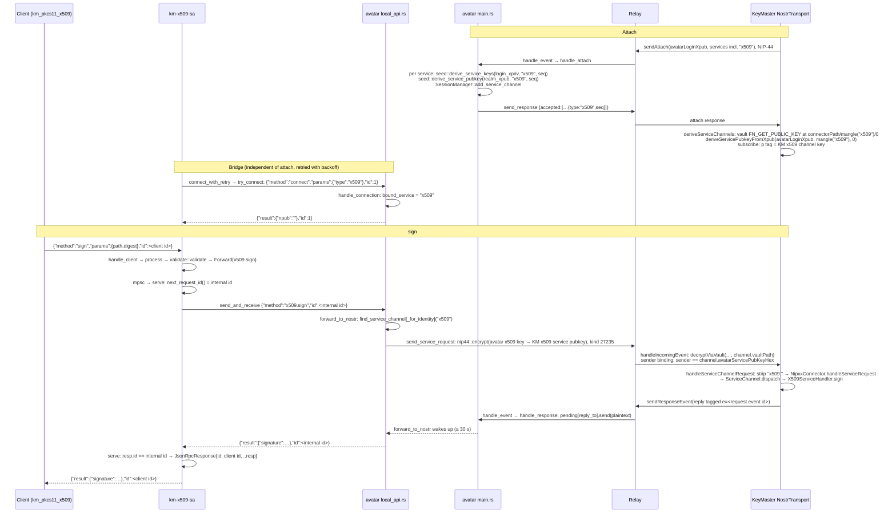
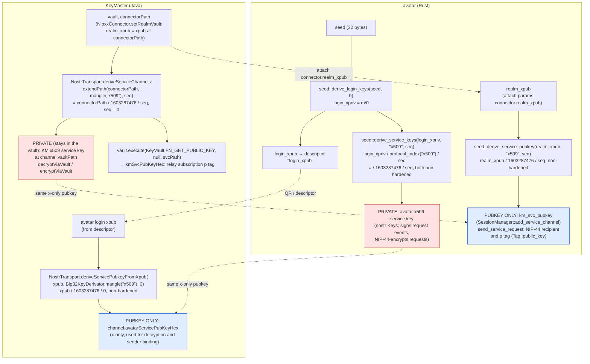

# km-x509-sa: X.509 Service Avatar

Status: As built in mission 37.1.3, commit `79e0a26`.

Function and file names in this document were read from the code. Where a
statement is inferred rather than read, it is marked *(inferred)*.

## 1. Purpose

`km-x509-sa` is the service avatar for X.509 signing. It owns a local Unix
socket that accepts `list`, `sign` and `import`. It checks each request and
forwards it to KeyMaster's `"x509"` service channel through the avatar local
API. Its client is the PKCS#11 module `km_pkcs11_x509` (mission 37.1.4,
[pkcs11-module.md](pkcs11-module.md)).

## 2. Code map

| File | Responsibility |
|---|---|
| `crates/km-x509-sa/src/main.rs` | CLI (`Cli`), client socket (`resolve_listen_socket`, `bind_client_socket`, `accept_loop`, `handle_client`, `process`), and the single avatar bridge (`bridge`, `connect_phase`, `connect_with_retry`, `try_connect`, `serve`, `send_and_receive`). Constants: `REQUEST_TIMEOUT` = 35 s, `CONNECT_TIMEOUT` = 5 s, `UNAVAILABLE` = `"avatar unavailable"`. |
| `crates/km-x509-sa/src/validate.rs` | The method allowlist and parameter checks: `validate(method, params) -> Result<Forward, JsonRpcError>`. Maps `list`/`sign`/`import` to `x509.list`/`x509.sign`/`x509.import` and rebuilds params from the validated fields only. `DIGEST_LEN` = 32. |
| `crates/km-x509-sa/src/tests.rs` | Validation tests (no socket) and socket tests against a fake avatar (see [section 9](#9-how-its-tested)). |
| `crates/avatar/src/main.rs:230` | The descriptor line `"services": ["ssh", "gpg", "nostr", "x509"]`. This tells KeyMaster that it can attach an `x509` channel. |
| `crates/avatar/src/main.rs` `handle_attach` | On attach, for each requested `(service_type, seq)`: `seed::derive_service_keys(login_xpriv, …)` and `seed::derive_service_pubkey(realm_xpub, …)`, then `SessionManager::add_service_channel`. |
| `crates/avatar/src/local_api.rs` | `handle_connection` binds a connection with `connect {type}`. `forward_to_nostr` sends each later request on that service's channel and waits 30 s for the reply. `send_service_request` encrypts it with NIP-44 into a kind-27235 event. |
| `crates/avatar/src/seed.rs` | `derive_login_keys` (m/0), `derive_service_keys` (private side), `derive_service_pubkey` (public side). Contains the x509 golden tests `t8_*`. |
| `crates/avatar-protocol/src/lib.rs` | `protocol_index(name)` = first 4 bytes of SHA-256(name), with the top bit cleared. JSON-RPC types and error constants. `read_line_message` / `write_line_message`. Test `t2_cross_language_x509` pins `protocol_index("x509")` = `0x5f9039b4` = 1603287476. |

KeyMaster side (repo `keymaster`, for reference): `X509ServiceHandler`,
`NostrTransport`, `ServiceChannel`. The wire contract is in
`keymaster/doc/X509.md`.

## 3. Client socket protocol

**Path.** Set by `--listen-socket <path>`. Without that flag the path is
`$XDG_RUNTIME_DIR/keymaster-x509-sa.sock`. If neither is set, or
`XDG_RUNTIME_DIR` is empty, startup fails with
`set XDG_RUNTIME_DIR or pass --listen-socket`. There is deliberately no
`/tmp` fallback. The socket is chmod `0600` right after bind. On startup
the program prints `X509_SA_SOCK=<path>` to stdout.

**Framing.** Newline-delimited JSON-RPC 2.0: one JSON object per line in each
direction. A connection can carry many requests, and they are answered in
order. Every request gets exactly one reply, and the reply carries the
client's own `id`.

### Methods

`list`: params must be absent, `null` or `{}`. Forwarded as `x509.list` with `{}`.

```json
{"jsonrpc":"2.0","id":1,"method":"list"}
{"jsonrpc":"2.0","result":{"keys":[{"label":"alice@atlanta.com tls-client","path":"m/44'/1240'/1955269225'/196866'/0'","public_key":"BLmbYNUB+MRBCDl3n76hmdh7g91nX/ulMiNSmt/Q8FrIPBma3aS3t6qtUK/T7UsjA2HmzlbqeHkHB8t9hKgaKoE=","id":"aEjYq+QB/j5mEbD87z6V2wzWw2yTgrsjaZ0hE6BhjIw="}]},"id":1}
```

Each key has `label`, `path`, `public_key` (65-byte SEC1 uncompressed P-256
point), `id` (SHA-256 of the DER SubjectPublicKeyInfo) and optionally `cert`
(certificate DER). `cert` is absent when no certificate is stored. All bytes
are standard Base64. The example values are Alice's key from the e2e test
(`ALICE_TLS_PUB_HEX`), with `id` computed from it.

`sign`: params must be an object with exactly `path` (a non-empty string)
and `digest` (Base64 that decodes to exactly 32 bytes). The caller does the
hashing. Forwarded as `x509.sign` with `{path, digest}`.

```json
{"jsonrpc":"2.0","id":2,"method":"sign","params":{"path":"m/44'/1240'/1955269225'/196866'/0'","digest":"hC5MBCCQhjdlaVqrzIueGMQQY0noOGA+bs+gTJeTlHI="}}
{"jsonrpc":"2.0","result":{"signature":"<base64 of 64 bytes, raw r || s>"},"id":2}
```

The signature is shown as a placeholder because it depends on the vault key.
The digest is SHA-256 of `keymaster x509 e2e`, the e2e test message.

`import`: params must be an object with exactly `der` (non-empty Base64).
Forwarded as `x509.import` with `{der}`.

```json
{"jsonrpc":"2.0","id":3,"method":"import","params":{"der":"MIIB..."}}
{"jsonrpc":"2.0","result":{"verdict":"ACCEPTED","stored":true},"id":3}
```

`verdict` is one of `ACCEPTED`, `MALFORMED`, `KEY_MISMATCH` or `EKU_MISMATCH`.
`stored` is `true` only for `ACCEPTED`. Every verdict comes back as a result,
never as an error.

km-x509-sa does not interpret results. It passes the avatar's response
through and only puts the client's `id` back in place of the internal id.

### Errors

Errors produced by km-x509-sa, before anything is forwarded:

| Code | Message | When |
|---|---|---|
| -32700 | `parse error` | The line is not valid JSON. The reply has `id: null` and the connection stays open. |
| -32600 | `invalid request` | There is no string `method`. |
| -32601 | `method not found` | The method is anything other than `list`, `sign` or `import`. This includes `x509.sign`, `connect` and `gpg.sign`. |
| -32602 | `list takes no params` | `list` was sent with non-empty params. |
| -32602 | `params must be an object` | `sign` or `import` params are missing or are an array. |
| -32602 | `params must have exactly: path, digest` / `…: der` | A key is missing or an extra key is present. |
| -32602 | `'path' must be a non-empty string` | |
| -32602 | `'digest' must be a string` / `'der' must be a string` | |
| -32602 | `'digest' is not valid base64` / `'der' is not valid base64` | |
| -32602 | `'digest' must decode to exactly 32 bytes` | |
| -32602 | `'der' must not be empty` | |
| -32603 | `avatar unavailable` | Not connected to the avatar (the reply is immediate). Also: the request waited more than 35 s in the queue, the avatar connection failed during the request, no answer arrived within 35 s, the response id did not match, or the bridge task is gone. |

Errors from KeyMaster's x509 handler. All of them use code -32603.
`NostrTransport.handleServiceChannelRequest` wraps every handler error this
way, and the message is the contract:

| Message | When |
|---|---|
| `unknown-path` | `sign`: `path` is not, character for character, a listed path. |
| `invalid-digest` | `sign`: the digest is missing or not 32 bytes. km-x509-sa's own check makes this unreachable through the socket. |
| `unsupported` | `import` with no metadata store (Android, until 37.2). |
| `request denied by user` | The user denied an ASK-policy method (`sign`, `import`). |
| `unknown method: <m>` | A method the handler does not have. km-x509-sa's allowlist makes this unreachable through the socket; the e2e test reaches it by going straight to the avatar API. |
| `sign failed: status=<n>` | The vault's `FN_SIGN` was not OK (`IllegalStateException` in `X509ServiceHandler.sign`). |

Errors from the avatar local API, passed through unchanged
(`avatar-protocol` constants, raised in `local_api::forward_to_nostr`):

| Code | Message | When |
|---|---|---|
| -32001 | `no service channel available` | No KeyMaster session has attached `x509`. This includes the time when km-x509-sa is connected but nobody has attached yet. |
| -32002 | `failed to send request` | Publishing to the relay failed. |
| -32003 | `timeout` | KeyMaster did not answer within 30 s. |
| -32004 | `response channel dropped` | |

## 4. Request flow



Notes:

- The attach is not wired to km-x509-sa. The `connect` succeeds even when no
  channel exists, because `handle_connection` does not check for one. Until a
  KeyMaster attaches `x509`, requests come back with -32001.
- `find_service_channel_for_identity` is used on per-user sockets
  (`start_user_listener`). `find_service_channel` is used on the default
  socket (`start_default_listener`).
- KeyMaster echoes the request `id` into its reply, so the avatar returns
  km-x509-sa's internal id. This is read from `handleServiceChannelRequest`,
  which copies `payload.id`.

## 5. Channel key derivation

The x509 channel uses two key pairs, one per side. This section covers the
avatar's pair, which is the key KeyMaster binds requests to. The avatar
derives it privately and KeyMaster derives the same public key from the
avatar's login xpub. The KeyMaster-side pair works the other way round: the
avatar derives KeyMaster's channel pubkey from `realm_xpub` with
`derive_service_pubkey`, and KeyMaster derives the private key in its vault
at `connectorPath / mangle("x509") / 0`.



Red: the private keys. The avatar holds its key in memory as nostr `Keys`.
KeyMaster's key never leaves the vault: NIP-44 runs through
`decryptViaVault` and `encryptViaVault` with `channel.vaultPath`. Blue: the
same keys as the other side knows them, as public keys only.

Two caveats on this diagram:

- KeyMaster always uses `seq = 0` (`int seq = 0` in `deriveServiceChannels`).
  The avatar takes `seq` from the attach `services` entry and defaults it to 0.
- The avatar uses the x-only form, which is bytes 1..33 of the compressed key
  (`derive_service_pubkey`). KeyMaster does the same *(inferred from its
  `x-only` comment and from the golden test passing; `deriveServicePubkeyFromXpub`'s
  body was not read)*.

**Golden values.** Public BIP39 test mnemonic `abandon … about`, empty
passphrase:

| Value | |
|---|---|
| BIP39 seed | `5eb00bbd…ce9e38e4` (64 bytes) |
| xpub at m/0 | `xpub68jrRzQfUmwSaf5Y37Yd5uwfnMRxiR14M3HBonDr91GB7GKEh7R9Mvu2UeCtbASfXZ9FdNo9FwFx6a37HNXUDiXVQFXuadXmevRBa3y7rL8` |
| `protocol_index("x509")` / `mangle("x509")` | `1603287476` = `0x5f9039b4` |
| x-only pubkey at xpub / 1603287476 / 0 | `09d8987776ec7b88ac17e00d02e887fc1a99b9b36741a915537b4951b6ecd8b5` |

Tests that assert them:

| Side | Test | Asserts |
|---|---|---|
| Rust | `avatar-protocol` `t2_cross_language_x509` | `protocol_index("x509")` = `0x5f9039b4` = 1603287476 |
| Rust | `avatar` `seed::tests::t8_x509_golden_from_fixed_xpub` | xpub → `derive_service_pubkey` = `09d89877…d8b5` |
| Rust | `avatar` `seed::tests::t8_x509_same_pubkey_both_sides` | seed → m/0 reproduces the xpub string. `derive_service_keys` (private) and `derive_service_pubkey` (public) both give `09d89877…d8b5`. |
| Rust | `avatar` `seed::tests::t8_x509_differs_from_other_services` | The x509 key differs from the ssh, gpg and nostr keys. |
| Java | `keymaster` `NostrTransportTest.x509ChannelGolden` | mnemonic → seed hex, m/0 xpub string, `deriveServicePubkeyFromXpub(xpub, mangle("x509"), 0)` = `09d89877…d8b5` |
| Java | `keymaster` `X509ServiceHandlerTest.mangleX509Golden` | `mangle("x509")` = 1603287476 = `0x5f9039b4` |

`avatar-protocol`'s comment says the T2 values "must match Java
`MangleTest.t2_*`". `keyvault`'s `MangleTest` has no x509 case, so on the
Java side the x509 mangle value is pinned in `X509ServiceHandlerTest`
instead.

## 6. Behaviour

**Single bridge with internal ids.** All client connections feed one `mpsc`
channel (capacity 32) into one `bridge` task. That task holds one avatar
connection. The avatar local API handles a connection strictly as
request → `forward_to_nostr` → reply, so there is nothing to gain from
pipelining on a single connection. A single bound connection also keeps the
`connect` handshake and the reconnect logic in one place.
`serve` gives each request `next_request_id()` (a global counter starting at
2; 1 is reserved for `connect`). The client's id never reaches the avatar,
so two clients using the same id cannot receive each other's answers. A
reply whose id is not the internal id causes a -32603 and a reconnect.

**Timeouts.** `REQUEST_TIMEOUT` = 35 s is applied twice. A request that has
waited more than 35 s in the queue gets -32603 without being sent. One
avatar round trip is also limited to 35 s. The avatar's own wait in
`forward_to_nostr` is 30 s, so normally the avatar's `-32003 timeout` arrives
first. After a 35 s timeout, km-x509-sa drops the avatar connection so that
a late reply cannot be paired with the next request. A client can therefore
wait up to about 70 s: nearly 35 s in the queue plus 35 s for the round trip
*(inferred from the two checks)*. `CONNECT_TIMEOUT` = 5 s limits the
`connect` handshake.

**While reconnecting.** `connect_phase` races `connect_with_retry` against
the queue. Backoff is 1 s, doubling up to 30 s. Every request that arrives
during this phase gets -32603 `avatar unavailable` immediately and is not
queued.

**Idle-disconnect detection.** While waiting for the next request, `serve`
also polls `conn.reader.fill_buf()`. The avatar never sends unsolicited
data, so EOF, an error or any bytes all mean the connection is gone, and the
bridge reconnects before the next request arrives.

**Abandoned requests.** If the client has gone (`req.reply.is_closed()`), the
request is skipped without being forwarded.

**Stale socket.** `bind_client_socket` removes any existing file at the
listen path before binding. A crashed instance therefore never blocks a
restart. This also means a second instance would take over the path from
the first.

**Logging** (`tracing`, default level `info`, `RUST_LOG` overrides
`--log-level`):

- Logged at info: the method name and the decoded payload size
  (`[x509] sign (32 bytes)`). Local rejections (method name, message, code).
  The outcome (`ok`, or the error code and message from the avatar or
  KeyMaster). Connect and reconnect events.
- Not logged by km-x509-sa: `path`, `digest`, `der`, `signature`, the key
  list, or client ids. Rejection messages name the field but never its value.
  The method name in a rejection is whatever the client sent.
- Other components: the avatar logs `Local API: method=… id=…` at debug
  level. It does not log params *(read from `handle_connection`)*. KeyMaster's
  `NostrTransport.handleIncomingEvent` logs the decrypted plaintext at debug
  (`Decrypted from {}: {}`), which includes `path` and `digest`/`der`.

## 7. Running it

**systemd user unit** `km-x509-sa.service`:

```ini
[Unit]
Description=KeyMaster X.509 service avatar
After=network.target

[Service]
Type=simple
ExecStart=/usr/lib/keymaster-avatar/bin/km-x509-sa \
    --avatar-socket /run/keymaster-avatar/api-%U.sock \
    --listen-socket %t/keymaster-x509-sa.sock
Restart=on-failure
RestartSec=5

[Install]
WantedBy=default.target
```

`%U` is the user's uid, which matches the avatar's per-user socket
`api-<uid>.sock` from `start_user_listener`. `%t` is `$XDG_RUNTIME_DIR`. The
unit belongs on the packaging branch (`debian/km-x509-sa.service`, installed
to `/usr/lib/systemd/user/` by `debian/rules`). **As of this writing it is
not on `origin/packaging/debian/trixie` or `origin/packaging/ubuntu/resolute`;
both were last updated 2026-10-27. It exists only in
`~/projects/startup/37.1.3-packaging.patch`, which is the source of the text
above.**

**e2e container** (`keymaster-e2e-test/docker/avatar/entrypoint.sh`): a shell
restart loop, the same pattern as the other service avatars:

```sh
(while true; do km-x509-sa --avatar-socket /tmp/keymaster-avatar.sock \
    --listen-socket /tmp/keymaster-x509-sa.sock --log-level debug || true; sleep 1; done) &
```

`--listen-socket` is required there because `XDG_RUNTIME_DIR` is not set.

**The avatar does not spawn service avatars.** The `avatar` crate starts no
processes (it has no `std::process::Command`). Service avatars are started
by systemd or the entrypoint loop, and they find the avatar by its socket.

## 8. What this does not protect against

- **Same-user processes.** The client socket is `0600`, so any process
  running as the user can call `list`, `sign` and `import`. km-x509-sa does
  not authenticate its clients.
- **The `connect` type is not a security boundary.** The avatar local API
  accepts any non-empty `type` in `connect`. It also lets a connection send
  `connect` again with a different type (`bound_service` is simply
  overwritten), and it forwards any method on the bound channel. Two things
  isolate the x509 channel:
  - km-x509-sa's allowlist in `validate::validate`. Only `list`, `sign` and
    `import` with well-formed params are forwarded.
  - KeyMaster's per-channel handler and sender binding. Events on the x509
    channel are dispatched only to `X509ServiceHandler` (other methods get
    `unknown method: …`), and only if the sender is the avatar's x509 service
    key. A request signed with another channel's key is dropped
    (`NostrTransportTest.x509RequestFromTheGpgAvatarKeyIsDropped`).

  A same-user process that talks to the avatar API directly can still send
  any x509 method KeyMaster's handler accepts.
- **Approval policy is KeyMaster's.** `list` is APPROVE, while `sign` and
  `import` are ASK. With `auto` policy
  (`DaemonController`, which the e2e tests use) everything is approved without
  a prompt. km-x509-sa has no say in this.
- **Serial bridge.** Requests go to the avatar one at a time. A `sign` waiting
  on a user prompt holds up every other client's request until it is answered
  or times out. Queued requests older than 35 s fail with `avatar unavailable`.

## 9. How it's tested

**Unit tests**, `cargo test -p km-x509-sa` (`crates/km-x509-sa/src/tests.rs`):

Validation (no socket):

- `validate_unknown_method_is_not_found`
- `validate_list_accepts_no_params`
- `validate_list_rejects_params`
- `validate_sign_ok_forwards_exactly_path_and_digest`
- `validate_sign_rejects_bad_params`
- `validate_import_ok`
- `validate_import_rejects_bad_params`
- `listen_socket_flag_wins_over_xdg`
- `listen_socket_defaults_to_xdg_runtime_dir`
- `listen_socket_without_xdg_is_an_error`

Socket tests (need AF_UNIX, so they cannot run inside the sandbox). Each
runs against a fake avatar (`start_fake_avatar`) and calls `run()`:

- `client_socket_mode_0600`
- `stale_socket_replaced`
- `e2e_invalid_request_not_forwarded`: -32602 and -32601, and the fake
  avatar saw only `x509.list`.
- `two_clients_same_id`: both clients use id 1 concurrently. Each gets its
  own result, and the avatar saw two distinct internal ids.
- `avatar_drops_mid_request`: -32603 `avatar unavailable` with the client's id.
- `request_while_disconnected_immediate_error`
- `silent_avatar_times_out`: 300 ms timeout → -32603.

Related Rust tests: `seed::tests::t8_*` and `avatar-protocol`
`t1_31_bit_range`, `t1_different_inputs_differ`, `t2_cross_language_x509`
(see [section 5](#5-channel-key-derivation)).

**e2e**, `keymaster-e2e-test` `KeyMasterAvatarTest` (commit `760ec93`). Each
test attaches alice@atlanta.com with `auto` policy, polls `list` until it
succeeds, and detaches at the end:

| Order | Test | Checks |
|---|---|---|
| 70 | `x509ListServesAliceTlsClientKey` | One key: the path, the label, a 65-byte `public_key` equal to `ALICE_TLS_PUB_HEX`, a 32-byte `id`, and no `cert`. |
| 71 | `x509SignVerifiesWithListedKey` | Signs SHA-256 of the message. The 64-byte `r‖s` verifies as SHA256withECDSA against the listed key. |
| 72 | `x509SaRespawnsOnCrash` | `pkill -x km-x509-sa`. A new PID appears within 10 s. After that, a sign still verifies. |
| 73 | `x509ChannelRejectsForeignMethods` | With gpg and x509 attached, `connect {type:x509}` + `gpg.sign_request` sent straight to the avatar API gets KeyMaster's -32603 `unknown method: gpg.sign_request`. Through km-x509-sa the same request gets -32601 and is never forwarded. |
| 74 | `x509SignRejectsShortDigest` | A 31-byte digest gets -32602 from km-x509-sa, not KeyMaster's -32603 `invalid-digest`. |

## Stale docs (not fixed here)

These docs still describe a `service.spawn` round trip. Service channels are
now derived from xpubs with no extra round trip (see `session.rs:9`,
`NostrTransport.java:45`, and the e2e assertion that the avatar logs do not
contain `service.spawn`).

- `keymaster-avatar/doc/e2e-sequence.md:22-31`: a "For each service (ssh, gpg)" loop with `service.spawn` request and response.
- `keymaster-avatar/doc/deployment-sequence.md:29-37`: the same loop under "Service channel setup".
- `keymaster-android/docs/avatar-nostr-sequence.md:16-26`: `create` / `service.spawn` / `connect` control plane.
- `keymaster-android/docs/avatar-nostr-design.md`: lines 66, 172-174, 224-260, 360, 402, 409 (the `service.spawn` request/response spec and open questions).
- Borderline: `keymaster-avatar/doc/DEPLOYMENT.md:60` says the avatar "spawns service channels". It does not name `service.spawn`, but the wording suggests it.

Historical mission plans in `keymaster-wks/plan/done/` (13, 13.1, 13.2,
11.1, 20, 26.3, 36.3.4) also mention `service.spawn`. They are records of
past missions, not current docs.
